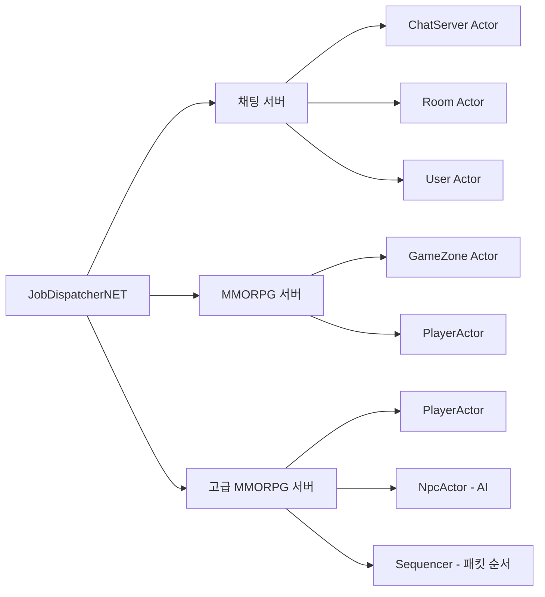

# 제1장: JobDispatcherNET 입문과 Actor 모델

멀티스레딩에서 발생하는 문제를 출발점으로 JobDispatcherNET의 역할을 살펴본다. 이어서 Actor 모델의 직렬 실행 원리, 기본 사용법, 메시지 패싱과 상태 접근 규칙을 익힌다.

## 1.1 게임 서버의 공포, 멀티스레딩

게임 서버를 처음 만들어 보면 이런 코드를 짜게 됩니다.

```csharp
// 플레이어 HP를 다루는 코드 — 이것이 왜 위험할까요?
public class Player
{
    public int Hp { get; set; }

    public void TakeDamage(int damage)
    {
        Hp -= damage;         // ← 이 줄이 실은 여러 단계로 실행됩니다!
        if (Hp <= 0)
            Die();
    }
}
```

얼핏 보면 문제없어 보입니다. 그런데 여러 스레드가 동시에 이 코드를 실행하면?

```
시간 ──────────────────────────────────────────────────────►

스레드 A (몬스터1 공격): Hp 읽기(100) ─────────────────── Hp 쓰기(100-30=70)
스레드 B (몬스터2 공격):               Hp 읽기(100) ─ Hp 쓰기(100-50=50)

결과: Hp = 50  ← 몬스터1의 30 데미지가 증발했습니다!
실제 기대값: 100 - 30 - 50 = 20
```

이것을 **레이스 컨디션(Race Condition)**이라 합니다. 두 스레드가 같은 데이터에 동시에 접근해서 서로의 결과를 덮어쓰는 버그입니다.

---

## 1.2 전통적인 해결책: lock

보통은 이렇게 고칩니다:

```csharp
public class Player
{
    private readonly object _lock = new();
    public int Hp { get; private set; }

    public void TakeDamage(int damage)
    {
        lock (_lock)   // ← 한 번에 한 스레드만 들어오게!
        {
            Hp -= damage;
            if (Hp <= 0)
                Die();
        }
    }
}
```

작동은 합니다. 하지만 문제가 있습니다:

```
┌─────────────────────────────────────────────┐
│             lock의 문제점                    │
├─────────────────────────────────────────────┤
│ 1. 성능 저하    — 스레드가 줄 서서 기다림   │
│ 2. 데드락 위험  — A가 B를 기다리고          │
│                   B가 A를 기다리면 영구 정지 │
│ 3. 코드 복잡성  — 모든 shared state에       │
│                   lock을 걸어야 함           │
│ 4. 실수하기 쉬움 — lock을 빠뜨리면 버그     │
└─────────────────────────────────────────────┘
```

게임 서버에 플레이어가 1만 명이고, 매 틱(50ms)마다 수천 개의 작업이 발생한다면... lock 경합이 심각해집니다.

---

## 1.3 더 나은 방법: Actor 모델

Actor 모델은 다른 철학을 가집니다:

> **"공유 상태를 없애자. 대신 메시지를 주고받자."**

각 객체(Actor)는 자신만의 **작업 큐**를 가집니다. 외부에서는 직접 상태를 변경하지 않고, 큐에 "이 작업을 해줘"라는 메시지를 넣습니다. Actor는 자신의 큐에서 작업을 하나씩 꺼내 **직렬(순서대로)**로 처리합니다.

```
        [스레드 A]    [스레드 B]    [스레드 C]
            │             │             │
            ▼             ▼             ▼
        DoAsync()     DoAsync()     DoAsync()
            │             │             │
            └─────────────┴─────────────┘
                          │
                          ▼
                   ┌──────────────┐
                   │  Player 큐   │
                   │  [작업1]     │
                   │  [작업2]     │
                   │  [작업3]     │
                   └──────┬───────┘
                          │ 순서대로 처리
                          ▼
                   Player.TakeDamage()
                   Player.TakeDamage()
                   Player.TakeDamage()
                   (항상 직렬 실행 — lock 불필요!)
```

이것이 **JobDispatcherNET**이 구현하는 핵심 아이디어입니다.

---

## 1.4 JobDispatcherNET이란?

JobDispatcherNET은 .NET에서 Actor 모델을 쉽게 구현하기 위한 라이브러리입니다.

```
┌─────────────────────────────────────────────────────────┐
│                  JobDispatcherNET                        │
│                                                          │
│  ┌─────────────────┐    ┌──────────────────────────┐    │
│  │  AsyncExecutable │    │   JobDispatcher          │    │
│  │                  │    │                          │    │
│  │  • 각 객체에게   │    │  • N개의 전용 OS 스레드  │    │
│  │    자기만의 큐를  │    │  • 유휴 시 시그널 대기   │    │
│  │    부여          │    │  • 워커 자동 재기동      │    │
│  │  • lock 없는     │    │  • <T> 로 자체 루프도    │    │
│  │    직렬 처리     │    └──────────────────────────┘    │
│  └─────────────────┘                                     │
│                                                          │
│  ┌─────────────────┐    ┌──────────────────────────┐    │
│  │  TimerService    │    │   Sequencer<T>           │    │
│  │                  │    │                          │    │
│  │  • 지연·주기 실행│    │  • 패킷 순서 보장        │    │
│  │  • 취소 가능한   │    │  • IO 스레드와 워커       │    │
│  │    핸들 반환     │    │    스레드 분리            │    │
│  │  • 시스템당 1스레드│  │                          │    │
│  └─────────────────┘    └──────────────────────────┘    │
│                                                          │
│  ┌───────────────────────────────────────────────────┐  │
│  │  JobSystem — 위 셋과 메트릭·셧다운 게이트의 소유자│  │
│  └───────────────────────────────────────────────────┘  │
└─────────────────────────────────────────────────────────┘
```

---

## 1.5 이 라이브러리로 만들 수 있는 것

이 책에서 다룰 예제들을 살펴봅시다:



---

## 1.6 이 책을 읽기 전에 알아야 할 것

이 책을 최대한 활용하려면 다음 내용을 알고 있으면 좋습니다:

```
알면 좋은 것                알아도 되고 몰라도 되는 것
───────────────────────    ─────────────────────────────
✓ C# 기본 문법              △ async/await (라이브러리가
✓ 클래스와 상속               lock 없이 직렬화를 해주므로
✓ 람다(Lambda) 표현식          많이 안 씁니다)
✓ 인터페이스(interface)     △ Task<T>의 내부 동작 원리
✓ Thread가 무엇인지          △ 고급 lock 패턴
  (개념 정도만)
```

---

## 1.7 소스 코드 구조

저장소를 열면 다음 폴더들이 보입니다:

```
JobDispatcherNET/
├── JobDispatcherNET/          ← 핵심 라이브러리 (여기서 시작!)
│   ├── AsyncExecutable.cs     ← Actor의 기반 클래스
│   ├── JobSystem.cs           ← 워커·타이머·메트릭·셧다운의 소유자
│   ├── JobDispatcher.cs       ← 워커 스레드 풀 (비제네릭 / 제네릭)
│   ├── JobEntry.cs            ← 작업 항목 + 풀링
│   ├── TimerService.cs        ← 지연·주기 실행 (시스템당 스레드 1개)
│   ├── ThreadContext.cs       ← 스레드 전용 저장소
│   ├── Sequencer.cs           ← 패킷 순서 보장
│   ├── JobOptions.cs          ← actor 옵션 + ExecutionMode/DropReason
│   ├── JobMetrics.cs          ← 메트릭 수집
│   ├── JobDiagnostics.cs      ← 데드락 가드
│   ├── IJobLogger.cs          ← 로깅 인터페이스
│   ├── IRunnable.cs           ← 워커 자체 루프 인터페이스
│   └── Legacy.cs              ← [Obsolete] 호환 표면 (TimerRegistry)
│
├── ExampleConsoleApp/         ← 예제 1: 기본기 (제5장)
├── ExampleChatServer/         ← 예제 2: 채팅 서버 (제5장)
├── ExampleMmorpgServer/       ← 예제 3: MMORPG (제6장)
└── AdvancedMmorpgServer/      ← 예제 4: 고급 MMORPG (제6장)
```

---

라이브러리의 역할과 소스 구조를 확인했다. 이어서 Actor 모델의 핵심 원리와 직렬 실행을 코드와 다이어그램으로 살펴본다.

## 1.8 "직렬 실행"이 뭔가요?

직렬(Serial) 실행이란 한 번에 하나씩 순서대로 처리하는 것입니다.

```
병렬(Parallel) 실행:       직렬(Serial) 실행:
┌──────────────────┐       ┌──────────────────┐
│ 작업1 ────────── │       │ 작업1            │
│ 작업2 ────────── │       │       ▼          │
│ 작업3 ────────── │       │     작업2         │
│ (동시에!)        │       │       ▼          │
└──────────────────┘       │     작업3         │
                           │ (순서대로!)       │
                           └──────────────────┘
```

직렬 실행이면 같은 데이터에 동시에 접근하는 일이 없으므로 lock이 필요 없습니다!

---

## 1.9 큐(Queue)가 직렬 실행을 만드는 원리

JobDispatcherNET에서 모든 Actor는 자기만의 **작업 큐**(`ConcurrentQueue<JobEntry>`)를 가집니다.
외부에서 작업을 넣으면(DoAsync), Actor는 큐에서 하나씩 꺼내 처리합니다.

```
                   외부 스레드들
         Thread-A    Thread-B    Thread-C
            │            │           │
            │ DoAsync()  │ DoAsync() │ DoAsync()
            ▼            ▼           ▼
         ┌────────────────────────────────┐
         │   ConcurrentQueue<JobEntry>    │
         │  ┌────────┐┌────────┐┌──────┐ │
         │  │ 작업 1 ││ 작업 2 ││작업3 │ │
         │  └───┬────┘└───┬────┘└──┬───┘ │
         └──────┼─────────┼────────┼─────┘
                │         │        │
                ▼ (순서대로)        │
         ┌──────────────────────────┐
         │       Flush 루프         │
         │  작업1 실행               │
         │  작업2 실행  ← 하나씩!   │
         │  작업3 실행               │
         └──────────────────────────┘
```

여러 스레드가 동시에 DoAsync를 호출해도, 큐 안에서 순서가 정해지고 하나씩 실행됩니다.
"동시에 실행하는 스레드는 최대 하나"라는 보장은 큐 자체가 아니라 **입장 카운터의 CAS** 가
만듭니다 (2.3에서 자세히).

---

## 1.10 AsyncExecutable 기본 사용법

모든 Actor는 `AsyncExecutable`을 상속합니다.

```csharp
// 이렇게 만들면 됩니다!
public class Player : AsyncExecutable
{
    private int _hp = 100;      // lock 없이 안전하게 쓸 수 있는 필드

    // ✅ 외부에서 호출하는 진입점 — DoAsync로 큐에 넣기만 합니다
    public void TakeDamage(int damage)
        => DoAsync(() => ProcessTakeDamage(damage));

    // ✅ 실제 처리 — 항상 이 Actor의 큐에서 직렬 실행됩니다
    private void ProcessTakeDamage(int damage)
    {
        _hp -= damage;           // lock 없이 안전! (직렬 실행 보장)
        Console.WriteLine($"HP: {_hp}");
        if (_hp <= 0)
            ProcessDie();
    }

    private void ProcessDie()
    {
        Console.WriteLine("사망!");
    }
}
```

---

## 1.11 큐 기반 직렬 실행의 증명

코드로 직접 확인해봅시다:

```csharp
var player = new Player();

// 10개 스레드에서 동시에 데미지를 입힙니다
var tasks = Enumerable.Range(0, 10)
    .Select(i => Task.Run(() => player.TakeDamage(10)))
    .ToArray();

await Task.WhenAll(tasks);
// 결과: HP = 0 (정확히 100 - 10*10)
// lock 없이도 정확합니다!
```

```
시간 ─────────────────────────────────────────────────────►

Thread-1: TakeDamage(10) → DoAsync → 큐에 넣기 끝
Thread-2: TakeDamage(10) → DoAsync → 큐에 넣기 끝
Thread-3: TakeDamage(10) → DoAsync → 큐에 넣기 끝
...

         큐: [데미지10][데미지10][데미지10]...[데미지10]
              ↑ 순서대로 처리 →

HP: 100 → 90 → 80 → 70 → 60 → 50 → 40 → 30 → 20 → 10 → 0
         (한 번에 하나씩, 결과가 정확합니다!)
```

---

## 1.12 코딩 컨벤션 — Handle/Process 패턴

JobDispatcherNET 예제들은 일관된 코딩 패턴을 따릅니다:

```csharp
public class SomeActor : AsyncExecutable
{
    // ────────────────────────────────────────────────────
    // 외부 진입점 (public)
    // 규칙: "큐에 넣기만 하고 즉시 반환"
    // ────────────────────────────────────────────────────

    public void HandleSomething(int value)
        => DoAsync(() => ProcessSomething(value));
    //            ↑ 딱 이것만! 실제 처리는 private로 분리

    // ────────────────────────────────────────────────────
    // 실제 처리 (private)
    // 규칙: "Actor 큐에서 직렬 실행, 여기서 상태 변경"
    // ────────────────────────────────────────────────────

    private void ProcessSomething(int value)
    {
        // 여기서 안전하게 상태를 바꿀 수 있습니다
        _someState = value;
    }
}
```

왜 이렇게 나누나요?

```
┌─────────────────────────────────────────────────────────┐
│  Handle* vs Process* 분리의 이유                         │
├─────────────────────────────────────────────────────────┤
│  1. 디버거 스택트레이스가 명확해집니다                   │
│     "HandleMove → DoAsync → Flush → ProcessMove"        │
│                                                          │
│  2. grep으로 찾기 쉽습니다                               │
│     "ProcessMove를 grep → 실제 처리 로직 바로 찾기"     │
│                                                          │
│  3. 의도가 명확합니다                                    │
│     Handle = "접수만 함"                                │
│     Process = "실제 처리"                               │
└─────────────────────────────────────────────────────────┘
```

---

## 1.13 Actor 간 메시지 패싱

Actor끼리 서로에게 메시지를 보낼 수 있습니다. 이것이 진짜 Actor 모델입니다:

```csharp
public class Room : AsyncExecutable  // Room도 Actor!
{
    private List<Player> _players = new();

    // Room Actor에게 채팅 메시지 전달을 부탁합니다
    public void BroadcastChat(string message)
        => DoAsync(() => ProcessBroadcastChat(message));

    private void ProcessBroadcastChat(string message)
    {
        // Room 큐 안에서 실행 — _players 접근 안전!
        foreach (var player in _players)
        {
            // Player Actor의 큐에 메시지 전달을 넣습니다
            player.ReceiveMessage(message);  // player의 DoAsync 호출
        }
    }
}
```

```
Chat 이벤트 발생
      │
      ▼
room.BroadcastChat("안녕!")      ← 큐에 넣기
      │
      ▼
[Room 큐에서 실행]
ProcessBroadcastChat("안녕!")
  │
  ├─► player1.ReceiveMessage("안녕!")   ← player1 큐에 넣기
  ├─► player2.ReceiveMessage("안녕!")   ← player2 큐에 넣기
  └─► player3.ReceiveMessage("안녕!")   ← player3 큐에 넣기
                │
                ▼
         각 Player 큐에서
         직렬 실행됨
```

Room은 _players 목록에 lock 없이 접근하고, 각 Player에게 메시지를 보낼 때도 lock 없이 안전합니다. **모든 상태 접근이 직렬화됩니다.**

---

## 1.14 Actor 모델의 핵심 규칙

```
╔═══════════════════════════════════════════════════════════╗
║  Actor 모델의 황금률                                      ║
╠═══════════════════════════════════════════════════════════╣
║                                                           ║
║  ✅ Actor 내부 상태는 Actor 자신의 큐에서만 접근한다      ║
║  ✅ 외부에서는 DoAsync로 메시지를 보내기만 한다          ║
║  ✅ Actor 간 통신은 DoAsync를 통한 메시지 패싱으로 한다   ║
║                                                           ║
║  ❌ Actor 필드를 외부 스레드에서 직접 읽거나 쓰지 않는다 ║
║  ❌ Actor 메서드 안에서 다른 Actor의 큐를 기다리지 않는다 ║
║     (데드락 위험!)                                        ║
║                                                           ║
╚═══════════════════════════════════════════════════════════╝
```

---

## 1.15 언제 lock이 아직 필요한가?

Actor 모델이 완벽한 것은 아닙니다. 다음 상황에서는 여전히 주의가 필요합니다:

```csharp
// 예외 상황 1: 여러 Actor가 동시에 접근하는 공유 인덱스
// ConcurrentDictionary 같은 스레드 안전한 컬렉션을 사용합니다
private static readonly ConcurrentDictionary<int, Entity> _index = new();

// 예외 상황 2: Actor 외부에서 읽어야 하는 경우
// 읽기도 큐를 통과시킨다 — Ask(async 호출자) / AskSync(동기 호출자)
public Task<SomeSnapshot> GetSnapshotAsync()
    => Ask(() => new SomeSnapshot(/* 현재 상태 복사 */));

public SomeSnapshot GetSnapshot()
    => AskSync(() => new SomeSnapshot(/* 현재 상태 복사 */), TimeSpan.FromSeconds(2));
    // ★ AskSync 는 actor 작업 안에서 호출하면 예외를 던진다 (데드락 방지)
```

이 패턴들은 제5장에서 채팅 서버 예제로 자세히 다룹니다.

---

## 1.16 Actor 모델 정리

```
이번 장에서 배운 것
──────────────────────────────────────────────
✓ 직렬 실행 = 한 번에 하나씩 순서대로 처리
✓ actor 마다의 큐 + 입장 CAS 가 직렬 실행을 보장
✓ Actor = AsyncExecutable을 상속한 클래스
✓ Handle*(외부 진입) / Process*(실제 처리) 패턴
✓ Actor 간 통신 = DoAsync를 통한 메시지 패싱
✓ lock 없이도 데이터 일관성 보장됨
```

---

*[↑ 목차](./README.md) | [→ 제2장: AsyncExecutable 실행 코어와 작업 풀링](./chapter02.md)*
