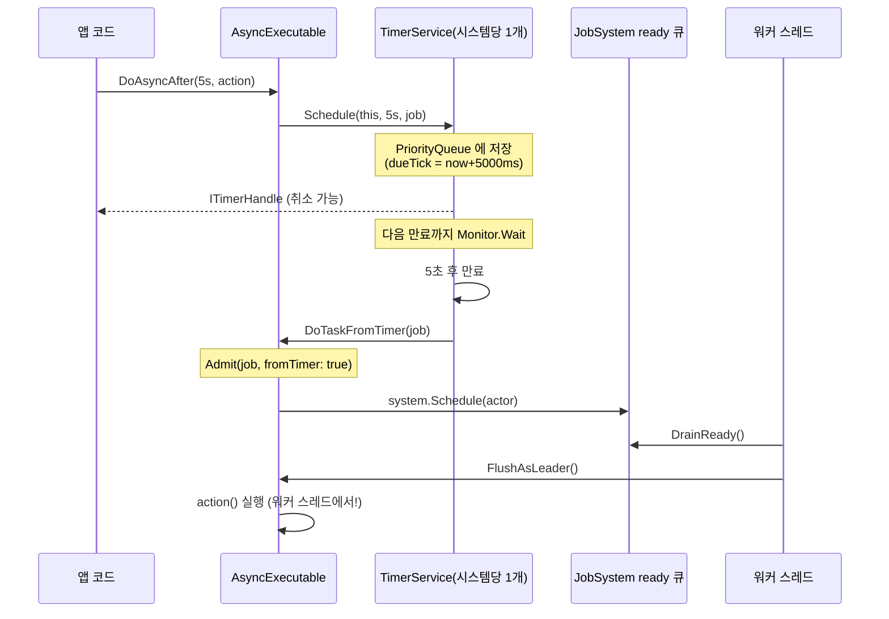
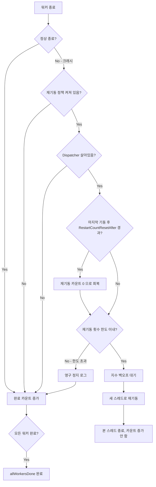

# 제3장: 타이머와 워커 스레드의 실행 구조

지연·주기 작업을 관리하는 TimerService와 ThreadContext를 먼저 살펴본다. 이어서 JobDispatcher와 IRunnable을 통해 워커의 시작, 대기, 자동 재기동과 종료가 어떻게 연결되는지 분석한다.

## 3.1 타이머는 어디에서 살아야 하나?

`DoAsyncAfter(5초, ...)`를 호출하면 누군가는 5초를 세고 있어야 합니다. 그 "누군가"를 어디에
두느냐가 이 장의 전부입니다. 선택지는 셋입니다.

```
① 예약한 스레드마다 하나씩 둔다        ← v1 / v2.0 이 택했던 방식
   장점: 락 없음, ThreadLocal 로 간단
   단점: 그 스레드가 죽으면 타이머도 같이 죽는다 ★

② ThreadPool 타이머(System.Threading.Timer)를 쓴다
   장점: 만들기 쉽다
   단점: 콜백이 ThreadPool 스레드에서 실행 → actor 코드가 워커 밖으로 샌다
         ThreadPool 이 포화되면 게임 틱이 밀린다

③ JobSystem 마다 전용 타이머 스레드를 하나 둔다     ← 지금 방식
   장점: 소유자가 명확하고, 워커가 죽어도 타이머는 산다
        발화는 actor 큐로 넘기므로 실행은 여전히 워커에서
   단점: 스레드 1개를 상시 점유 (대신 대기 중에는 CPU 0%)
```

①의 단점이 실제 장애로 이어진 것이 P0-2 결함입니다. 워커가 예외로 죽어 supervisor 가
재기동하면, **그 워커 스레드에서 예약해 둔 타이머가 전부 사라졌습니다.** NPC AI tick 체인,
부활 타이머, AOI 재동기화가 조용히 영구 정지하고, 메트릭에도 잡히지 않았습니다.

그래서 v2.1 은 ③으로 바꿨습니다.

---

## 3.2 TimerService — 시스템당 전용 스레드 1개

```
JobSystem "game"
   ├─ 워커 스레드 8개        (JobWorker-game-0 ~ 7)
   ├─ 타이머 스레드 1개      (JobTimer-game)         ← 이 장의 주인공
   ├─ ready 큐
   └─ 메트릭
```

`TimerService`는 `internal` 클래스입니다. 사용자가 직접 만들거나 참조하지 않고,
`DoAsyncAfter` / `DoAsyncEvery` 를 통해서만 씁니다. 내부는 아주 단순합니다:

```csharp
internal sealed class TimerService : IDisposable
{
    private const int MaxWaitMs = 1000;

    private readonly object _lock = new();
    private readonly PriorityQueue<TimerEntry, long> _queue = new();   // 만료 시각 최소 힙
    private readonly List<TimerEntry> _dueBuffer = [];
    private readonly Thread _thread;   // "JobTimer-{system.Name}", AboveNormal, IsBackground
    private long _pending;
}
```

핵심 루프는 "가장 빨리 만료될 항목까지 자고, 깨어나서 만료된 것을 꺼내 던진다"입니다.

```csharp
while (살아있는 동안)
{
    lock (_lock)
    {
        CollectDueLocked();               // 만료된 항목을 _dueBuffer 로

        if (_dueBuffer.Count == 0)
        {
            if (_queue.Count == 0)
            {
                Monitor.Wait(_lock, MaxWaitMs);   // 예약이 하나도 없음 → 최대 1초 대기
                continue;
            }

            _queue.TryPeek(out _, out var nextDue);
            var remaining = nextDue - CurrentTick;
            if (remaining <= 0) continue;

            Monitor.Wait(_lock, (int)Math.Min(remaining, MaxWaitMs));  // 다음 만료까지 대기
            continue;
        }
    }

    DispatchDue();                        // 락 밖에서 발화
}
```

`PeriodicTimer(1ms)` 를 돌리지 않는 것이 포인트입니다. **예약이 없으면 이 스레드는 완전히
잠들어 있고, 새 예약이 들어오면 `Monitor.Pulse`로 깨어납니다.** 워커 8개면 ThreadPool 에
1ms 주기 태스크가 8개 돌던 예전 구조와 비교됩니다.

`PriorityQueue`를 쓰는 이유는 그대로입니다:

```
일반 Queue:            PriorityQueue (최소 힙):

[A: 500ms]             [B: 100ms] ← 맨 앞 (가장 빨리 만료)
[B: 100ms]             [C: 200ms]
[C: 200ms]             [A: 500ms]

순서대로 꺼내면         만료 시각 순으로 꺼냄
B를 빨리 처리 못함      → "다음 만료까지 잔다" 가 가능해짐
```

---

## 3.3 예약에서 실행까지

```csharp
// AsyncExecutable
public ITimerHandle DoAsyncAfter(TimeSpan delay, Action action)
{
    ArgumentNullException.ThrowIfNull(action);

    if (!TryReserve(out var reason))       // 셧다운/Dispose/faulted 면 예약 자체를 거부
    {
        Refuse(reason);
        return CancelledTimer.Instance;    // Cancel() == false, IsPending == false
    }

    return _system.Timers.Schedule(this, delay, Job.Rent(action));
}
```

발화 경로는 다음과 같습니다:



여기서 중요한 것은 **타이머 스레드가 사용자 코드를 직접 실행하지 않는다**는 점입니다.
타이머 스레드는 `actor.DoTaskFromTimer(job)` 만 호출하고, 그 안의 `Admit(..., fromTimer: true)`이
actor 를 ready 큐에 올립니다. 실행은 워커에서 일어납니다. 타이머 스레드가 느린 콜백에 붙들려
다음 만료를 놓치는 일이 없습니다.

만료 시각이 지난 뒤 실제로 발화하기까지 걸린 시간(lag)은
`EnableDetailedMetrics` 를 켜면 히스토그램으로 기록됩니다 (`jobdispatcher.timer.lag`).

---

## 3.4 취소 — ITimerHandle

```csharp
public interface ITimerHandle
{
    /// 발화 전이면 취소하고 true. 이미 발화했거나 이미 취소됐으면 false.
    /// 주기 타이머는 이후 모든 발화가 멈춘다.
    bool Cancel();

    /// 아직 한 번 이상 발화할 예정인가
    bool IsPending { get; }
}
```

취소는 "폐기된 객체를 타이머가 붙들고 있는" 문제를 없앱니다.

```csharp
// ❌ 예전 방식 — 취소가 없으니 플래그로 무시했다
private volatile bool _despawned;

private void RespawnTick()
{
    if (_despawned) return;   // 발화는 하되 아무것도 안 함
    ...
}
// → 타이머가 actor 참조를 계속 붙들고 있어 GC 도 지연되고,
//   셧다운 시 "남은 타이머"가 계속 발화해 드레인이 끝나지 않는다

// ✅ 지금 방식 — 진짜로 취소한다
private ITimerHandle? _respawnTimer;

private void ProcessReceiveDamage(...)
{
    if (!_npc.IsAlive)
        _respawnTimer = DoAsyncAfter(TimeSpan.FromSeconds(8), static a => a.Respawn(), this);
}

private void ProcessDespawn()
{
    _despawned = true;
    _tickTimer?.Cancel();
    _respawnTimer?.Cancel();   // ← 예약을 실제로 없앤다
}
```

취소된 타이머의 `Job`은 `Discard()`로 풀에 반납되고(2.21), `TimersCancelled` 카운터가 올라갑니다.

---

## 3.5 DoAsyncEvery — 주기 실행

```csharp
public ITimerHandle DoAsyncEvery(
    TimeSpan period,              // 반복 간격 (양수여야 함)
    Action action,
    TimeSpan? initialDelay = null // 첫 발화까지의 지연. 생략하면 period 와 같다
);
```

이 API 가 대체하는 것이 **"작업이 끝나면서 자기 자신을 다시 예약"하는 자기복제 패턴**입니다.
그 패턴에는 두 가지 문제가 있었습니다.

```
문제 1 — 예외 한 번에 체인이 끊긴다
    private void Tick()
    {
        DoWork();                              // ← 여기서 예외!
        DoAsyncAfter(_interval, Tick);         // ← 이 줄에 도달하지 못함
    }
    로그 한 줄 남기고 그 NPC 는 영원히 멈춘다. 재무장할 방법도 없다.

문제 2 — 드리프트(drift)
    "작업이 끝난 시점" 부터 다시 200ms 를 세므로,
    작업이 5ms 걸리면 실제 주기는 205ms 가 된다. 1시간이면 1분 이상 밀린다.
```

`DoAsyncEvery`는 둘 다 해결합니다.

```csharp
// TimerService.DispatchDue — 주기 항목 재무장
_system.Metrics.OnTimerFired();
_system.DispatchTimerJob(entry.Owner, Job.Rent(action));   // 발화는 actor 큐로

// 드리프트 방지: "끝난 시각"이 아니라 "예정 시각"에 period 를 더한다.
// 단, 과거로는 예약하지 않는다 (밀렸을 때 폭주 방지).
var next = entry.DueTick + ToMillis(entry.Period);
if (next <= now) next = now + ToMillis(entry.Period);
Enqueue(entry, next, isNew: false);
```

발화와 재무장이 **타이머 스레드에서** 일어나므로, actor 큐 안에서 콜백이 예외를 던져도
다음 틱은 정상적으로 옵니다. 정지는 핸들을 `Cancel()` 하는 것 하나뿐입니다.

```csharp
// AdvancedMmorpgServer/NpcActor.cs
private void ProcessStart()
{
    if (_despawned) return;

    // 첫 틱만 0~interval 사이로 흩어서 50마리가 같은 ms 에 몰리지 않게 한다
    var jitter = TimeSpan.FromMilliseconds(
        Random.Shared.Next(0, Math.Max(1, (int)_tickInterval.TotalMilliseconds)));

    _tickTimer = DoAsyncEvery(_tickInterval, Tick, jitter);
}
```

```
t=0     DoAsyncEvery(200ms, Tick, jitter=73ms)
t=73    Tick()
t=273   Tick()
t=473   Tick()  ← 여기서 예외가 나도
t=673   Tick()  ← 다음 틱은 온다
...
        _tickTimer.Cancel()  → 종료
```

> 주기 타이머는 살아 있는 동안 `PendingTimerCount` 에 **1** 로만 계수됩니다. 발화할 때마다
> 카운트가 올라가 내려오지 않던 버그(그래서 `DrainAsync`/`StopAsync` 가 항상 타임아웃까지
> 기다리던 문제)는 2.1 에서 고쳐졌습니다.

---

## 3.6 TimerPrecision — 정확도와 OS 해상도

```csharp
public enum TimerPrecision
{
    /// 만료 시각까지 잔다. CPU 0%. 정확도는 OS 타이머 해상도에 좌우된다.
    Coarse,   // 기본값

    /// 만료 직전까지 자고 그다음부터 스핀. 서브 밀리초 정확도, 대신 CPU 를 잠깐 태운다.
    High,
}
```

```csharp
var system = new JobSystem(new JobSystemOptions
{
    Name = "game",
    TimerPrecision = TimerPrecision.High,
    TimerSpinThresholdMs = 16,          // 만료 16ms 전부터 스핀 시작
    RaiseSystemTimerResolution = false, // 아래 설명 참조
});
```

**반드시 알아야 할 OS 제약이 있습니다.**

```
Monitor.Wait / Thread.Sleep 의 실제 해상도
──────────────────────────────────────────────────────────
Windows (기본):  약 15.6ms   ← "10ms 뒤"를 부탁해도 15.6ms 뒤에 깨어날 수 있다
Windows (다른 프로세스가 timeBeginPeriod 를 올린 경우): 1ms
Linux:           약 1ms
──────────────────────────────────────────────────────────

즉 Coarse 모드에서 200ms 틱은 충분히 정확하지만, 5ms 틱은 정확하지 않습니다.
```

Windows 에서 이 해상도 자체를 1ms 로 올리는 opt-in 옵션이 `RaiseSystemTimerResolution` 입니다.
`timeBeginPeriod(1)` 을 호출하는 것으로, **프로세스 전역이 아니라 시스템 전역에 영향을 주고
전력 소비를 올립니다.** 측정으로 필요성을 확인한 뒤에만 켜세요. 기본값은 꺼짐입니다.

```
튜닝 순서 권장
1) Coarse 로 시작한다. 대부분의 서버 틱(50~200ms)에는 이걸로 충분하다.
2) EnableDetailedMetrics 로 jobdispatcher.timer.lag 히스토그램을 본다.
3) p99 lag 이 목표를 넘으면 → TimerPrecision.High
4) 그래도 부족하고 Windows 라면 → RaiseSystemTimerResolution = true (전력 비용 감수)
```

---

## 3.7 워커가 없을 때 — P0-3 과 폴백

`AsyncExecutable` 하나만 만들어 쓰는 가장 단순한 사용법에서는 `JobDispatcher` 가 없습니다.
이때 타이머가 발화하면 넘겨줄 워커가 없습니다.

```csharp
// AsyncExecutable.Admit, fromTimer 경로
if (fromTimer)
{
    if (_system.HasWorkers)
    {
        _system.Schedule(this);        // 정상 경로: 워커에게 넘긴다
        return true;
    }

    // 디스패처가 하나도 없다. 조용히 사라지게 두는 대신(v2.0 동작)
    // 이 자리(타이머 스레드)에서 실행하고, 그 사실을 한 번만 알린다.
    _system.WarnTimerFallbackOnce();
    RunFlushLoop();
    return true;
}
```

로그는 딱 한 번만 나옵니다:

```
[JobDispatcherNET][Warn] JobSystem 'default' has no worker threads, so timer callbacks run
on the timer thread. Start a JobDispatcher to move them onto dedicated workers.
```

> **v2.0 에서는 이랬다 (P0-3)**
> 만료된 타이머 작업은 `TimerDispatchQueue` 라는 전역 큐에 들어갔고, **그 큐를 드레인하는 것은
> 워커의 `Run` 루프뿐이었습니다.** 워커가 없는 프로세스에서는 `DoAsyncAfter` 가 아무것도 하지
> 않고, 경고조차 없었습니다. 5장의 `ExampleConsoleApp` 이 `Test count: 41` 대신 `26` 을 찍던
> 원인이 바로 이것입니다. 예전 문서에 있던 *"디스패처 없이도 지연 실행이 정상 트리거된다"* 는
> 서술은 v1 시절의 동작을 그대로 옮긴 것이었고, v2.0 에서는 사실이 아니었습니다.
> 지금은 다시 사실이 되었습니다 — 단, 워커가 없으면 콜백이 타이머 스레드에서 돈다는 조건과
> 함께입니다.

---

## 3.8 ThreadContext — 남아 있는 것들

`ThreadContext`는 여전히 존재하지만, 이제 타이머와는 무관합니다. `[ThreadStatic]` 필드
네 개뿐입니다 (`ThreadLocal<T>` 보다 hot path 에서 쌉니다).

```csharp
public static class ThreadContext
{
    /// 이 스레드가 지금 flush 중인 actor. null 이면 actor 작업 밖.
    public static AsyncExecutable? CurrentExecuter { get; internal set; }

    /// 이 스레드가 다른 actor 를 flush 하는 동안 leader 가 된 actor 들의 대기열.
    /// 가장 바깥 flush 루프가 드레인하므로 중첩 디스패치가 재귀하지 않는다.
    public static Queue<AsyncExecutable> ExecuterQueue { get; }

    /// JobSystem 기준 단조 증가 ms. 워커가 틱마다 갱신한다.
    public static long TickCount { get; set; }

    /// JobDispatcher 가 만든 스레드인가. ExecutionMode.Scheduled 판정에 쓰인다.
    public static bool IsWorkerThread { get; internal set; }

    /// 이 워커 스레드를 소유한 JobSystem (워커 밖에서는 null).
    public static JobSystem? CurrentSystem { get; internal set; }
}
```

`ThreadContext.Timer` 는 **없습니다.** 스레드마다 타이머를 갖는 설계 자체가 사라졌기 때문입니다.

`TickCount` 는 워커 루프가 매 반복마다 갱신합니다:

```csharp
// JobDispatcherBase.PumpReadyQueue
protected int PumpReadyQueue()
{
    ThreadContext.TickCount = System.CurrentTick;
    return System.DrainReady(Options.MaxReadyDrainPerTick);
}
```

`IRunnable` 안에서 락 없는 주기 작업을 만들 때 유용합니다:

```csharp
public bool Run(CancellationToken cancellationToken)
{
    long now = ThreadContext.TickCount;   // 이 스레드만의 값 → 락 불필요
    if (now - _lastHeartbeatTick >= 5000)
    {
        _lastHeartbeatTick = now;
        Console.WriteLine($"Worker alive — tick={now}ms");
    }
    return true;
}
```

---

## 3.9 v2.0 에서는 이랬다 — 사라진 세 가지

예전 코드를 본 적이 있다면 다음 세 타입을 기억할 겁니다. **셋 다 지금은 없거나 no-op 입니다.**

```
TimerQueue           스레드마다 하나씩 있던 PriorityQueue + PeriodicTimer(1ms).
  (제거됨)           - 예약한 스레드가 소유자였다 → 그 스레드가 죽으면 타이머도 죽었다 (P0-2)
                     - 워커 8개 + IO 스레드 N개면 ThreadPool 에 1ms 주기 태스크가 그만큼 돌았다

TimerDispatchQueue   만료된 작업을 워커에게 넘기던 전역 큐.
  (제거됨)           - 워커의 Run 루프만 드레인했다 → 워커가 없으면 영원히 발화 안 함 (P0-3)

TimerRegistry        모든 TimerQueue 를 WeakReference 로 추적하던 레지스트리.
  ([Obsolete],       - 종료 시 DisposeAll() 로 일괄 정리하는 용도였다
   전부 no-op)       - JobSystem 이 타이머 스레드를 소유하고 함께 Dispose 하므로 할 일이 없다
```

```csharp
// 예전 코드는 그대로 컴파일되지만 아무 일도 하지 않는다
TimerRegistry.DisposeAll();     // no-op

// 대신
await system.StopAsync(TimeSpan.FromSeconds(10));   // 타이머 스레드도 여기서 정리된다
```

바꾼 이유를 한 줄로 요약하면: **타이머의 수명은 "예약한 스레드"가 아니라 "작업이 속한
시스템"에 묶여야 하기 때문입니다.**

---

## 3.10 셧다운과 남은 타이머

`JobSystem.StopAsync` / `Dispose` 는 타이머 스레드를 정지시키고, 아직 발화하지 않은 예약을
모두 폐기합니다.

```csharp
// TimerService.DiscardAll (Dispose 경로)
while (_queue.Count > 0)
{
    var entry = _queue.Dequeue();
    if (entry.IsCancelled) continue;
    entry.DiscardJob();                        // Job 은 풀로
    Interlocked.Decrement(ref _pending);
    _system.Metrics.OnTimerDiscarded();        // ★ 버려진 개수가 메트릭에 남는다
}
```

```
셧다운 시 확인할 것
──────────────────────────────────────────────────────────
TimersDiscarded 가 크다  → 종료 시점에 아직 살아 있던 예약이 많다는 뜻.
                          NPC tick / 부활 타이머를 Despawn 에서 Cancel 하고 있는지 확인.
                          (AdvancedMmorpgServer 의 GameWorld.Stop 이 하는 일이 정확히 이것)
```

셧다운 전에 타이머 체인을 정리해 두면 `DrainAsync` 가 실제로 "할 일 없음" 상태에 도달할 수
있습니다. 정리하지 않으면 주기 타이머가 계속 새 작업을 만들어내므로 드레인이 타임아웃까지
갑니다.

```csharp
// AdvancedMmorpgServer/GameWorld.Stop
_isStopping = true;

DoAsync(static w =>
{
    foreach (var s in w._sessions.Values) s.Close();
    foreach (var na in w._npcs.Values)    na.Despawn();   // 내부에서 tick 타이머 Cancel
    foreach (var pa in w._players.Values) pa.Despawn();   // 내부에서 resync 타이머 Cancel
}, this);

// 예전의 Thread.Sleep(200) 대신 실제 정적 상태를 기다린다
System.DrainAsync(TimeSpan.FromSeconds(5)).GetAwaiter().GetResult();
```

---

## 3.11 타이머와 ThreadContext 정리

```
이번 장에서 배운 것
──────────────────────────────────────────────
✓ 타이머는 JobSystem 이 소유한 전용 스레드 1개가 관리한다
   (PriorityQueue + Monitor.Wait, 예약이 없으면 CPU 0%)
✓ 발화는 actor 큐 → ready 큐 → 워커. 타이머 스레드는 사용자 코드를 돌리지 않는다
✓ DoAsyncAfter / DoAsyncEvery 는 ITimerHandle 을 돌려준다 → Cancel() 가능
✓ DoAsyncEvery = 드리프트 없는 주기 실행 + 예외에 강한 체인
✓ TimerPrecision(Coarse/High)과 OS 해상도(Windows 기본 15.6ms) 이해
✓ 워커가 없으면 타이머 스레드에서 실행 + 1회 경고 (P0-3 수정)
✓ ThreadContext 에는 이제 Timer 가 없다
   (CurrentExecuter / ExecuterQueue / TickCount / IsWorkerThread / CurrentSystem)
✓ TimerQueue·TimerDispatchQueue 는 제거, TimerRegistry 는 no-op
```

---

타이머가 작업을 예약하고 Actor 큐로 전달하는 과정을 확인했다. 이제 그 작업을 처리하는 전용 워커 스레드의 구조와 생명주기를 살펴본다.

## 3.12 왜 전용 OS 스레드가 필요한가?

.NET의 `ThreadPool`은 편리하지만 게임 서버에 맞지 않는 부분이 있습니다:

```
ThreadPool의 특성:
──────────────────────────────────────────────────────────
✓ 작업이 끝나면 스레드 반환 → 다음 작업에 다른 스레드가 올 수 있음
✓ 스레드 수 자동 조절
✗ ThreadLocal 값이 작업 간에 유지 안 됨!
  (다른 스레드가 오면 다른 ThreadLocal)
✗ 긴 블로킹 작업이 풀을 굶긴다 (스레드 주입은 초 단위로 느리다)
✗ 스레드 우선순위 제어 어려움

전용 OS 스레드의 특성:
──────────────────────────────────────────────────────────
✓ 항상 같은 스레드 → ThreadLocal이 유지됨!
✓ 블로킹해도 다른 워크로드를 굶기지 않음
✓ IsBackground = true로 프로세스 종료 시 자동 중단
✓ 스레드 이름·우선순위·스택 크기 지정 가능 (디버깅·튜닝 편리)
```

---

## 3.13 두 가지 디스패처

v2.1 부터 디스패처는 **두 종류**입니다. 공통 부분(시작·감시·재기동·정지)은
`JobDispatcherBase`에 있고, 워커 루프의 본문만 다릅니다.

```
JobDispatcherBase (abstract)
   ├── JobDispatcher        ← 비제네릭. 사용자 루프 없음.
   │                          워커는 할 일이 없으면 시그널을 기다리며 블록한다.
   │                          작업이 전부 "actor 작업 / 타이머 발화 / JobSystem.Post"
   │                          로 들어오는 서버에 적합. (권장 기본값)
   │
   └── JobDispatcher<T>     ← 제네릭. T : IRunnable, new()
                              워커마다 T 인스턴스를 만들고 Run() 을 반복 호출한다.
                              워커에 자체 루프가 필요할 때 (게임 틱 루프 등).
```

```csharp
// ① 비제네릭 — 이제 대부분의 서버가 쓸 형태
_dispatcher = new JobDispatcher(workerThreads, new JobDispatcherOptions
{
    System = _system,
    RestartFailedWorkers = true,
});
_ = _dispatcher.RunWorkerThreadsAsync();

// ② 제네릭 — 워커에 자체 루프가 필요할 때
await using var dispatcher = new JobDispatcher<TestWorkerThread>(4);
_ = dispatcher.RunWorkerThreadsAsync();
```

### 비제네릭 워커 루프 — 폴링 없는 유휴 대기

```csharp
public sealed class JobDispatcher : JobDispatcherBase
{
    protected override void WorkerLoop(int slot, CancellationToken cancellationToken)
    {
        var idleWait = Math.Max(1, Options.IdleWaitMs);

        while (!cancellationToken.IsCancellationRequested)
        {
            if (PumpReadyQueue() == 0)      // 할 일이 있으면 처리하고 다시 확인
                System.WaitForWork(idleWait);  // 없으면 시그널이 올 때까지 블록
        }
    }
}
```

`JobSystem.WaitForWork`는 `Monitor.Wait`로 잠들고, 새 작업이 들어오면 producer 가
`Monitor.Pulse`로 깨웁니다.

```csharp
internal void WaitForWork(int timeoutMs)
{
    Interlocked.Increment(ref _waiters);   // ★ 큐를 보기 "전에" 대기자로 등록한다
    try
    {
        lock (_signal)
        {
            if (!_readyQueue.IsEmpty) return;   // 들어가기 직전에 일이 생겼다면 바로 나간다
            Monitor.Wait(_signal, timeoutMs);
        }
    }
    finally { Interlocked.Decrement(ref _waiters); }
}
```

대기자 등록을 먼저 하는 이유는 lost-wakeup 방지입니다. producer 는 `_waiters == 0` 이면
`Pulse`를 생략하는데, 워커가 "대기하러 들어가는 중"인 순간에 그 판단이 내려지면 아무도 깨우지
않은 채 잠들 수 있기 때문입니다.

```
v2.0 (모든 예제의 IRunnable):        v2.1 (비제네릭 JobDispatcher):

while (true) {                        while (true) {
    if (queue.TryDequeue(out var c))      if (PumpReadyQueue() == 0)
        c();                                  WaitForWork(20);
    else                              }
        Thread.Sleep(1);
}                                     · 유휴 시 CPU 0%, 깨우기는 시그널
                                      · 유입 지연 = 시그널 지연 (마이크로초)
· 워커 8개 → 초당 8,000회 깨어남
· Windows 타이머 해상도 때문에
  실제로는 1~15ms 유입 지연
```

---

## 3.14 IRunnable 인터페이스

```csharp
public interface IRunnable : IDisposable
{
    /// <summary>
    /// 전용 워커 스레드에서 반복 호출됩니다.
    /// true 반환: 계속 실행 / false 반환: 이 워커 종료
    /// </summary>
    bool Run(CancellationToken cancellationToken);
}
```

`JobDispatcher<T>`는 워커마다 `new T()`를 만들고, **ready 큐를 먼저 드레인한 뒤** `Run()`을
호출합니다.

```csharp
protected override void WorkerLoop(int slot, CancellationToken cancellationToken)
{
    var runner = new T();
    try
    {
        while (!cancellationToken.IsCancellationRequested)
        {
            PumpReadyQueue();                    // 타이머 발화·Scheduled actor 를 먼저 처리
            if (!runner.Run(cancellationToken))  // 그다음 사용자 루프
                break;
        }
    }
    finally
    {
        try { runner.Dispose(); }
        catch (Exception ex) { System.Logger.Error($"Worker slot #{slot} runner disposal failed", ex); }
    }
}
```

사용 예시:

```csharp
public class GameTickWorker : IRunnable
{
    private long _lastTick;

    public bool Run(CancellationToken cancellationToken)
    {
        if (cancellationToken.IsCancellationRequested)
            return false;

        long now = ThreadContext.TickCount;     // 워커가 매 반복 갱신해 준다
        if (now - _lastTick >= 50)
        {
            _lastTick = now;
            StepSimulation();
        }

        // 유휴 대기는 짧게. 순수 actor 워크로드라면 애초에 비제네릭 JobDispatcher 를 쓸 것.
        cancellationToken.WaitHandle.WaitOne(1);
        return true;
    }

    public void Dispose() { }
}
```

> `IRunnable`을 쓰기 전에 한 번 자문해 보세요. **"내 워커에 정말 자체 루프가 필요한가?"**
> 패킷 처리와 타이머 발화만 있다면 비제네릭 `JobDispatcher` 가 더 빠르고 코드도 없습니다.
> 예전 예제들이 `IRunnable` + `InboundCommands` + `Thread.Sleep(1)` 을 손으로 만들던 이유는
> 그때는 그 방법밖에 없었기 때문입니다 (3.22 참조).

---

## 3.15 JobDispatcherOptions — 워커 설정

```csharp
public sealed record JobDispatcherOptions
{
    public static readonly JobDispatcherOptions Default = new();

    /// <summary>워커가 예외로 죽으면 자동 재기동. 기본 true.</summary>
    public bool RestartFailedWorkers { get; init; } = true;

    /// <summary>슬롯당 최대 재기동 횟수. 기본 5. 초과 시 그 슬롯은 정지.</summary>
    public int MaxRestartsPerWorker { get; init; } = 5;

    /// <summary>재기동 간 대기 (지수 백오프 시작값). 기본 1초.</summary>
    public TimeSpan RestartBackoff { get; init; } = TimeSpan.FromSeconds(1);

    /// <summary>재기동 후 이만큼 정상 동작하면 재기동 예산을 회복. 기본 5분. Zero 면 비활성.</summary>
    public TimeSpan RestartCountResetAfter { get; init; } = TimeSpan.FromMinutes(5);

    /// <summary>한 반복에서 ready 큐를 최대 몇 개까지 처리할지. 기본 256.</summary>
    public int MaxReadyDrainPerTick { get; init; } = 256;

    /// <summary>유휴 워커가 시그널을 기다리는 최대 ms. 비제네릭 디스패처 전용. 기본 20.</summary>
    public int IdleWaitMs { get; init; } = 20;

    /// <summary>워커 스레드 우선순위. 기본 Normal.</summary>
    public ThreadPriority ThreadPriority { get; init; } = ThreadPriority.Normal;

    /// <summary>백그라운드 스레드로 띄울지. 기본 true (프로세스를 붙잡지 않음).</summary>
    public bool BackgroundThreads { get; init; } = true;

    /// <summary>워커 스택 크기(byte). 0 이면 플랫폼 기본값.</summary>
    public int MaxStackSize { get; init; }

    /// <summary>이 워커들이 서비스할 시스템. null 이면 JobSystem.Default.</summary>
    public JobSystem? System { get; init; }
}
```

> `MaxTimerDrainPerTick` 은 `MaxReadyDrainPerTick` 으로 이름이 바뀌었습니다. 타이머 전용 큐가
> 사라지고 공용 ready 큐로 합쳐졌기 때문입니다. 옛 이름도 `[Obsolete]` 로 남아 그대로 동작합니다.

지수 백오프 계산:

```
재기동 1회: 1초 × 2^0 = 1초 대기
재기동 2회: 1초 × 2^1 = 2초 대기
재기동 3회: 1초 × 2^2 = 4초 대기
재기동 4회: 1초 × 2^3 = 8초 대기
재기동 5회: 1초 × 2^4 = 16초 대기
→ 6회 시도: 최대 횟수 초과 → 그 슬롯은 정지
   (단, RestartCountResetAfter 만큼 건강하게 돌았다면 카운트가 0 으로 회복된다 — 3.19)
```

---

## 3.16 JobDispatcherBase 구조

```csharp
public abstract class JobDispatcherBase : IDisposable, IAsyncDisposable
{
    private readonly Thread[] _threads;             // 전용 OS 스레드들
    private readonly int[] _restartCounts;          // 슬롯별 재기동 횟수
    private readonly long[] _lastStartTimestamps;   // 슬롯별 마지막 기동 시각 (예산 회복 판정)
    private readonly CancellationTokenSource _cts = new();
    private TaskCompletionSource? _allWorkersDone;
    private int _completedWorkers;
    private int _disposed;
    private int _started;                           // 중복 시작 가드

    protected JobDispatcherBase(int workerCount, JobDispatcherOptions? options)
    {
        if (workerCount < 1)
            throw new ArgumentOutOfRangeException(nameof(workerCount), "must be >= 1");

        Options = options ?? JobDispatcherOptions.Default;
        System  = Options.System ?? JobSystem.Default;
        WorkerCount = workerCount;
        _threads = new Thread[workerCount];
        _restartCounts = new int[workerCount];
        _lastStartTimestamps = new long[workerCount];

        System.AttachDispatcher(this);   // ★ system.StopAsync 가 나를 정지시킬 수 있게 등록
    }

    public JobDispatcherOptions Options { get; }
    public JobSystem System { get; }
    public int WorkerCount { get; }
    public int LiveWorkerCount { get; }              // 살아 있는 스레드 수

    protected CancellationToken StoppingToken => _cts.Token;
    protected abstract void WorkerLoop(int slot, CancellationToken cancellationToken);
    protected int PumpReadyQueue();
}
```

`AttachDispatcher` 가 중요합니다. 디스패처는 자기를 소유한 `JobSystem`에 등록되고,
`system.StopAsync()` 한 번이 타이머 스레드와 이 디스패처를 함께 정리합니다.
사용자가 디스패처를 따로 `Dispose` 할 필요가 없어집니다.

---

## 3.17 RunWorkerThreadsAsync — 워커 시작 (1회 제한)

```csharp
public Task RunWorkerThreadsAsync()
{
    // ★ 두 번 부르면 예외. 예전에는 조용히 워커가 2N 개 떴다 (P0-5)
    if (Interlocked.Exchange(ref _started, 1) != 0)
        throw new InvalidOperationException(
            "RunWorkerThreadsAsync has already been called on this dispatcher.");

    ObjectDisposedException.ThrowIf(Volatile.Read(ref _disposed) != 0, this);

    _allWorkersDone = new TaskCompletionSource(TaskCreationOptions.RunContinuationsAsynchronously);

    for (var slot = 0; slot < WorkerCount; slot++)
        StartWorkerOnSlot(slot, isRestart: false);

    return _allWorkersDone.Task;   // 모든 워커가 종료되면 완료되는 Task
}

private void StartWorkerOnSlot(int slot, bool isRestart)
{
    var name = isRestart
        ? $"JobWorker-{System.Name}-{slot}-r{_restartCounts[slot]}"
        : $"JobWorker-{System.Name}-{slot}";

    var thread = Options.MaxStackSize > 0
        ? new Thread(() => RunWorker(slot), Options.MaxStackSize)
        : new Thread(() => RunWorker(slot));

    thread.IsBackground = Options.BackgroundThreads;
    thread.Name = name;                       // 시스템 이름이 들어가 디버깅이 쉽다
    thread.Priority = Options.ThreadPriority;

    _threads[slot] = thread;
    _lastStartTimestamps[slot] = Stopwatch.GetTimestamp();
    thread.Start();
}
```

> **왜 1회 가드가 필요했나 (P0-5)**
> 예전에는 `RunWorkerThreadsAsync()` 를 두 번 부르면 `_allWorkersDone` 이 덮어써지고 스레드가
> `2 × WorkerCount` 개 떴습니다. 첫 번째 Task 는 영원히 완료되지 않고, 워커 수는 설정의 두 배가
> 되는데 아무 경고도 없었습니다. "시작 코드가 두 경로에서 불리는" 흔한 실수가 조용한 자원 낭비로
> 이어지던 자리입니다.

---

## 3.18 RunWorker — 워커의 생명주기

```csharp
private void RunWorker(int slot)
{
    var exitedNormally = false;

    // ① 스레드 컨텍스트 표시 — ExecutionMode.Scheduled 판정과 진단에 쓰인다
    ThreadContext.IsWorkerThread = true;
    ThreadContext.CurrentSystem = System;
    System.RegisterWorker();               // system.LiveWorkerCount / HasWorkers 에 반영

    try
    {
        WorkerLoop(slot, _cts.Token);      // ② 실제 루프 (비제네릭 / 제네릭 구현체)
        exitedNormally = true;
    }
    catch (OperationCanceledException)
    {
        exitedNormally = true;             // 취소는 정상 종료
    }
    catch (Exception ex)
    {
        // ★ 어느 actor 를 돌리다 죽었는지까지 남긴다 (예전에는 스택만 남았다)
        var running = ThreadContext.CurrentExecuter;
        var where = running is null ? string.Empty : $" while running actor '{running.Name}'";
        System.Logger.Error($"Worker slot #{slot} crashed{where}", ex);
        AsyncExecutable.RaiseGlobalError(ex);
    }
    finally
    {
        ThreadContext.CurrentExecuter = null;
        ThreadContext.IsWorkerThread = false;
        ThreadContext.CurrentSystem = null;
        System.UnregisterWorker();
    }

    // ③ 비정상 종료면 supervisor 가 재기동을 시도
    if (!exitedNormally && Options.RestartFailedWorkers
        && Volatile.Read(ref _disposed) == 0 && !_cts.IsCancellationRequested)
    {
        if (TryRestart(slot))
            return;                        // 새 스레드가 이 슬롯을 이어받음
    }

    if (Interlocked.Increment(ref _completedWorkers) == WorkerCount)
        _allWorkersDone?.TrySetResult();
}
```

각 반복의 타임라인:

```
비제네릭 JobDispatcher:              제네릭 JobDispatcher<T>:

[PumpReadyQueue]                     [PumpReadyQueue]
   │ TickCount 갱신                     │ TickCount 갱신
   │ ready 큐에서 최대 256개               │ ready 큐에서 최대 256개
   │  (Scheduled actor / 타이머 발화 /      │
   │   JobSystem.Post 로 넣은 Action)      ▼
   ▼                                  [runner.Run(ct)]
[처리한 게 0 이면 WaitForWork]            false 반환 시 이 워커만 종료
```

> **v2.0 에서 사라진 줄**
> 예전 워커 종료 경로에는 `ThreadContext.Timer.Dispose()` 가 있었습니다. 이 한 줄이
> P0-2 — "워커가 죽으면 그 스레드의 타이머가 전부 사라진다" — 의 직접 원인이었습니다.
> 타이머가 시스템 소유가 된 지금은 워커 종료가 타이머에 아무 영향도 주지 않습니다.

---

## 3.19 워커 수퍼바이저 — 자동 재기동과 예산 회복

```csharp
private bool TryRestart(int slot)
{
    // ★ 이 슬롯이 충분히 오래 건강했다면 재기동 예산을 되돌려준다
    if (Options.RestartCountResetAfter > TimeSpan.Zero
        && Stopwatch.GetElapsedTime(_lastStartTimestamps[slot]) >= Options.RestartCountResetAfter)
    {
        Interlocked.Exchange(ref _restartCounts[slot], 0);
    }

    var attempts = Interlocked.Increment(ref _restartCounts[slot]);
    if (attempts > Options.MaxRestartsPerWorker)
    {
        System.Logger.Error(
            $"Worker slot #{slot} exceeded max restarts ({Options.MaxRestartsPerWorker}) — permanently down");
        return false;
    }

    System.Metrics.OnWorkerRestart();     // WorkerRestarts 메트릭 +1
    var backoff = TimeSpan.FromMilliseconds(
        Options.RestartBackoff.TotalMilliseconds * Math.Pow(2, attempts - 1));
    System.Logger.Warn(
        $"Restarting worker slot #{slot} (attempt {attempts}/{Options.MaxRestartsPerWorker}) after {backoff.TotalMilliseconds:F0}ms");

    Thread.Sleep(backoff);

    if (Volatile.Read(ref _disposed) != 0 || _cts.IsCancellationRequested)
        return false;

    StartWorkerOnSlot(slot, isRestart: true);
    return true;
}
```

예산 회복이 왜 필요한가:

```
회복이 없던 v2.0:

  1월 3일  워커 #2 크래시 ×5  → 예산 소진, 슬롯 #2 영구 정지
  1월 4일 ~ 6월    정상 운영... 하지만 워커는 계속 7/8 개
                   아무도 눈치채지 못한다 (로그는 5개월 전 것)

회복이 있는 v2.1 (기본 5분):

  마지막 재기동 후 5분간 살아 있었다면 → 그 슬롯의 카운트를 0 으로
  → "가끔 한 번씩 나는 크래시" 와 "지금 폭주 중인 크래시" 를 구분할 수 있다
```

수퍼바이저 동작 흐름:



---

## 3.20 TryStop / Dispose — 워커 종료

```csharp
public bool TryStop(TimeSpan joinTimeout)
{
    if (Interlocked.Exchange(ref _disposed, 1) != 0)
        return true;                      // 이미 정지됨

    System.DetachDispatcher(this);

    _cts.Cancel();                        // 모든 워커 루프에 종료 신호
    System.SignalWork();                  // 시그널 대기 중인 워커를 깨운다

    var allStopped = true;
    foreach (var thread in _threads)
    {
        if (thread is not { IsAlive: true }) continue;

        System.SignalWork();
        if (thread.Join(joinTimeout)) continue;

        allStopped = false;
        System.Logger.Error(
            $"Worker thread '{thread.Name}' did not stop within {joinTimeout.TotalMilliseconds:F0}ms. " +
            "A job is probably blocking (a lock, a synchronous wait, or an infinite loop).");
    }

    _cts.Dispose();
    return allStopped;                    // ★ 실제로 다 멈췄는지 호출자가 알 수 있다
}

public void Dispose() => TryStop(TimeSpan.FromSeconds(5));
```

`Dispose()`는 `Join` 타임아웃을 조용히 무시하던 예전 동작 대신, 멈추지 않은 스레드 이름과
원인 힌트를 로그에 남깁니다. 종료 성공 여부까지 필요하면 `TryStop`을 쓰세요.

**대부분의 경우 이것을 직접 부를 필요가 없습니다.** `system.StopAsync()` 가
등록된 디스패처들을 알아서 정리합니다.

---

## 3.21 실제 사용 패턴

```csharp
// 1. 가장 단순한 형태 — JobSystem.Default 위에서 워커 4개
await using var dispatcher = new JobDispatcher(4);
_ = dispatcher.RunWorkerThreadsAsync();

// 2. 명시적 시스템 + 수퍼바이저 옵션 (권장)
var system = new JobSystem(new JobSystemOptions { Name = "game" });
var dispatcher2 = new JobDispatcher(8, new JobDispatcherOptions
{
    System = system,
    RestartFailedWorkers = true,
    MaxRestartsPerWorker = 5,
    RestartBackoff = TimeSpan.FromSeconds(1),
    RestartCountResetAfter = TimeSpan.FromMinutes(5),
});
_ = dispatcher2.RunWorkerThreadsAsync();

// 3. 자체 루프가 필요할 때.
//    RunWorkerThreadsAsync 는 스레드를 띄우고 곧바로 반환하며, 두 번 호출하면 예외다.
//    모든 워커가 끝날 때까지 기다리고 싶으면 "첫 호출이 돌려준" Task 를 보관해 두었다가 await 한다.
await using var dispatcher3 = new JobDispatcher<GameTickWorker>(4);
var workersDone = dispatcher3.RunWorkerThreadsAsync();
// ... 종료 시점에
// await workersDone;

// 5. 종료 — 시스템 단위로 한 번에
await system.StopAsync(TimeSpan.FromSeconds(10));

// 6. 살아있는 워커 수 모니터링
Console.WriteLine($"활성 워커: {system.LiveWorkerCount} / {dispatcher2.WorkerCount}");
```

---

## 3.22 IO 스레드와 워커 스레드의 분리

게임 서버의 고전적인 요구사항입니다. **소켓 스레드는 소켓만, 워커 스레드는 로직만.**

```
[네트워크 IO 스레드들]            [워커 스레드들]
       │                              │
       │ 패킷 수신                     │ ready 큐 드레인
       ▼                              │
 세션 Sequencer.Enqueue(line)         │
       │                              ▼
       └──(CAS 로 1회)──► JobSystem.Post(drain) ──► 워커가 drain 실행
                                        │
                                        ▼
                                world.HandleMove(...)  → actor 큐로
```

v2.1 은 이 패턴에 필요한 조각을 라이브러리가 전부 제공합니다.

```csharp
// ① Sequencer 가 워커 풀에 직접 drain 을 예약한다 (4장)
_packetSequencer = new Sequencer<string>(
    server.System,                 // ← JobSystem.Post 로 스케줄
    handler: HandleOnePacket,
    onError: ex => JobLog.Error($"[session #{connId}] packet handling failed", ex));

// ② 그냥 Action 하나를 워커에서 돌리고 싶을 때
system.Post(() => world.ReloadConfig());

// ③ 비-워커 스레드가 actor 의 leader 가 되는 것 자체를 막고 싶을 때
new JobOptions { Mode = ExecutionMode.Scheduled }
```

```
┌─────────────────────────────────────────────────────────┐
│  IO 스레드와 워커 스레드 분리의 이점                     │
├─────────────────────────────────────────────────────────┤
│  IO 스레드: 순수 I/O — 네트워크 읽기/쓰기만 담당        │
│  워커 스레드: 순수 로직 — 게임 로직만 담당              │
│                                                          │
│  → IO 스레드가 게임 로직에 의해 막히지 않음             │
│  → Actor의 Flush가 항상 워커 스레드에서 실행            │
│  → ThreadContext 값이 항상 정확                         │
└─────────────────────────────────────────────────────────┘
```

> **v2.0 에서는 이랬다**
> 위의 세 조각이 전부 없었기 때문에, 모든 예제가 `public static ConcurrentQueue<Action>
> InboundCommands` 같은 중계 큐를 손으로 만들고 `IRunnable.Run` 에서 `TryDequeue` +
> `Thread.Sleep(1)` 로 돌렸습니다. 신규 사용자가 가장 많이 걸려 넘어지던 지점이기도 합니다.
> `AdvancedMmorpgServer` 에서는 이 수동 큐(`GameWorker.cs`)가 통째로 삭제되었습니다.
> `ExampleChatServer`/`ExampleMmorpgServer` 는 "예전 방식"의 참고 자료로 남아 있습니다.

---

## 3.23 워커와 디스패처 정리

```
이번 장에서 배운 것
──────────────────────────────────────────────
✓ JobDispatcher (비제네릭) = 사용자 루프 없음, 시그널 기반 유휴 대기
✓ JobDispatcher<T> = IRunnable 자체 루프가 필요할 때
✓ 공통 기반 JobDispatcherBase = 시작·감시·재기동·정지
✓ JobDispatcherOptions = 재기동/백오프/예산회복/유휴대기/우선순위/스택
✓ RunWorkerThreadsAsync 는 1회만 (두 번 호출 시 예외)
✓ RunWorker = 컨텍스트 등록 → WorkerLoop → 크래시 시 actor 이름까지 로그
✓ 수퍼바이저 = 지수 백오프 재기동 + RestartCountResetAfter 예산 회복
✓ TryStop(timeout) 은 실제 종료 여부를 bool 로 알려준다
✓ IO 분리는 Sequencer / JobSystem.Post / ExecutionMode.Scheduled 로
```

---

*[← 제2장: AsyncExecutable 실행 코어와 작업 풀링](./chapter02.md) | [↑ 목차](./README.md) | [→ 제4장: Sequencer와 설정·모니터링·로깅](./chapter04.md)*
