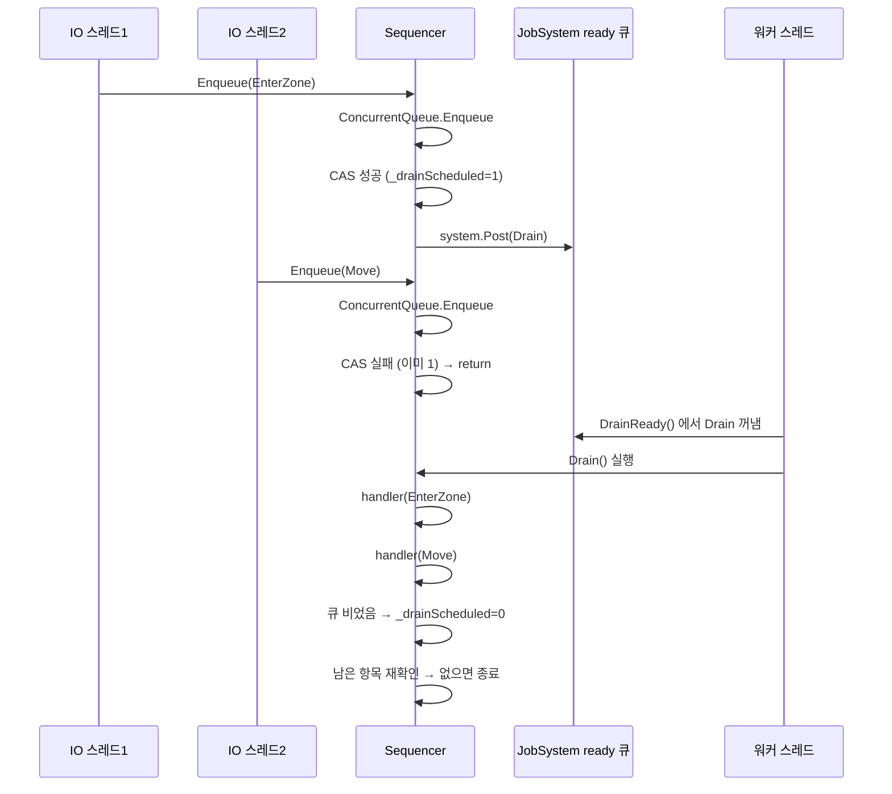

# 제4장: Sequencer와 설정·모니터링·로깅

Sequencer가 패킷 처리 순서를 보장하고 IO 스레드와 워커를 분리하는 원리를 살펴본다. 이어서 큐 제한, 오류 격리, 시스템 설정, 메트릭과 로깅을 묶어 운영에 필요한 제어 방법을 정리한다.

## 4.1 문제: 왜 순서가 깨질 수 있나?

여러 스레드가 같은 Actor에 작업을 보낼 때, 순서가 뒤집힐 수 있습니다.

```
실제 발생 가능한 문제:
────────────────────────────────────────────────────────

[IO 스레드 1]         [IO 스레드 2]
      │                     │
      ▼                     ▼
  패킷: EnterZone      패킷: Move
      │                     │
      ▼                     ▼
  zone.DoAsync(EnterZone)   zone.DoAsync(Move)

이 두 DoAsync가 거의 동시에 실행된다면?

DoAsync 내부 (입장 CAS → 큐 쓰기 순):
  Thread-1: CAS 성공(count=1) ──────────────────── Enqueue(EnterZone)
  Thread-2:   CAS 성공(count=2) ── Enqueue(Move)

actor 큐에 들어간 순서: [Move, EnterZone]  ← 뒤집힘!

※ actor 는 "한 번에 하나씩"은 보장하지만 "두 producer 중 누가 먼저 넣는지"는
   보장하지 않습니다. 이건 어떤 큐 구현을 쓰든 마찬가지입니다.

결과:
  Zone이 Move를 먼저 처리 → EnterZone을 나중에 처리
  → 아직 입장하지 않은 플레이어가 이동? 버그!
```

---

## 4.2 Sequencer의 설계 아이디어

`Sequencer<T>`는 이 문제를 해결합니다:

```
Sequencer의 역할:
──────────────────────────────────────────────────────────

1. 여러 IO 스레드가 Enqueue() → 내부 ConcurrentQueue에 순서대로 보관
2. CAS(Compare-And-Swap)로 단 하나의 스레드만 "드레인 권한"을 획득
3. 권한 획득자가 scheduleDrain 콜백 → 워커에게 drain 작업을 넘김
4. 워커가 Drain() 실행 → handler를 순서대로 호출
5. Drain 종료 후 남은 항목 있으면 다시 scheduleDrain

──────────────────────────────────────────────────────────
보장 ①: 같은 Sequencer의 항목은 Enqueue 순서대로 처리된다
보장 ②: 어느 순간에도 handler 를 실행 중인 스레드는 최대 1개다
보장 ③: Enqueue 가 true 를 반환했다면 그 항목은 반드시 처리된다
        (Stop() 이 곧바로 뒤따라도 — 이것이 v2.1 에서 고쳐진 P0-4)
```

---

## 4.3 Sequencer 코드 분석

```csharp
public sealed class Sequencer<T>
{
    private readonly ConcurrentQueue<T> _queue = new();   // ← 스레드 안전 큐
    private readonly Action<T> _handler;                   // ← 항목 처리자
    private readonly Action<Action> _scheduleDrain;        // ← drain을 워커에 예약
    private readonly Action<Exception>? _onError;
    private int _drainScheduled;   // 0: 드레인 없음, 1: 드레인 예약됨
    private int _stopped;          // 0: 실행 중, 1: 새 항목 거부
    private int _aborted;          // 1: 남은 항목까지 폐기

    /// <param name="handler">항목 하나를 처리. 직렬로, drain 을 실행하는 스레드에서 호출된다.</param>
    /// <param name="scheduleDrain">drain 작업을 워커 스레드에 넘기는 함수.</param>
    /// <param name="onError">handler 가 예외를 던졌을 때. 기본은 로깅.</param>
    public Sequencer(
        Action<T> handler,
        Action<Action> scheduleDrain,
        Action<Exception>? onError = null)
    {
        ArgumentNullException.ThrowIfNull(handler);
        ArgumentNullException.ThrowIfNull(scheduleDrain);
        _handler = handler;
        _scheduleDrain = scheduleDrain;
        _onError = onError;
    }

    /// <summary>
    /// ★ 편의 생성자 — drain 을 JobSystem 의 워커 풀에 직접 예약한다.
    /// 사용자가 중계용 InboundCommands 큐를 손으로 만들 필요가 없어졌다.
    /// </summary>
    public Sequencer(JobSystem system, Action<T> handler, Action<Exception>? onError = null)
        : this(handler, system.Post, onError) { }

    /// <summary>처리 대기 중인 항목 수.</summary>
    public int PendingCount => _queue.Count;

    /// <summary>Stop() 또는 Abort() 가 호출되었는가.</summary>
    public bool IsStopped => Volatile.Read(ref _stopped) != 0;
}
```

두 번째 생성자가 v2.1 의 실질적인 변화입니다. `scheduleDrain` 을 `system.Post` 로 연결해 주므로,
세션 클래스가 자기만의 워커 중계 큐를 들고 있을 이유가 사라집니다.

---

## 4.4 Enqueue — 항목 추가

```csharp
/// <returns>큐에 들어갔으면 true, 이미 중단된 sequencer 라 버려졌으면 false.</returns>
public bool Enqueue(T item)
{
    if (Volatile.Read(ref _stopped) != 0)
        return false;        // ★ 중단 상태 — 호출자가 "버려졌다"는 것을 알 수 있다

    _queue.Enqueue(item);    // ① ConcurrentQueue에 추가 (스레드 안전)
    TryScheduleDrain();      // ② 드레인 예약 시도
    return true;
}

private void TryScheduleDrain()
{
    // ③ CAS: _drainScheduled가 0이면 1로 바꾸기 (단 하나만 성공!)
    if (Interlocked.CompareExchange(ref _drainScheduled, 1, 0) != 0)
        return;  // 이미 누군가 예약함 → 내 일 없음

    try
    {
        // ④ 워커 큐에 Drain 작업 추가
        _scheduleDrain(Drain);
    }
    catch
    {
        // 예약 실패 시 CAS를 되돌려서 다음 Enqueue에서 재시도 가능하게
        Volatile.Write(ref _drainScheduled, 0);
        throw;
    }
}
```

CAS 동작 원리:

```
Thread-A와 Thread-B가 동시에 TryScheduleDrain 호출:

_drainScheduled = 0 (초기값)

Thread-A: CompareExchange(ref _drainScheduled, 1, 0)
Thread-B: CompareExchange(ref _drainScheduled, 1, 0)

두 스레드가 동시에 실행해도:
  Thread-A가 먼저 성공: _drainScheduled = 1 반환됨, 0 → 1 변경
  Thread-B: 현재값이 이미 1이므로 실패, 1 반환됨 → return

결과: Thread-A만 scheduleDrain 호출!
      → 워커 큐에 Drain이 딱 한 번만 추가됨!
```

---

## 4.5 Drain — 순서대로 처리

```csharp
private void Drain()
{
    try
    {
        // 큐에 있는 모든 항목 순서대로 처리 (Abort 되면 즉시 중단)
        while (Volatile.Read(ref _aborted) == 0 && _queue.TryDequeue(out var item))
        {
            try
            {
                _handler(item);  // 실제 처리!
            }
            catch (Exception ex)
            {
                if (_onError is not null) _onError(ex);
                else JobLog.Error("Sequencer handler error", ex);
            }
        }
    }
    finally
    {
        // ① CAS로 드레인 권한 해제
        Volatile.Write(ref _drainScheduled, 0);

        // ② 마지막 dequeue 와 ① 사이에 들어온 항목도 반드시 실행되어야 한다.
        //    ★ _stopped 는 일부러 조건에서 뺐다. Stop() 은 "새 항목 거부"이지
        //      "이미 받은 것을 버려라"가 아니다. 여기에 _stopped 검사가 있던 것이
        //      세션의 마지막 disconnect 마커를 잃던 원인이었다 (P0-4).
        if (!_queue.IsEmpty && Volatile.Read(ref _aborted) == 0)
            TryScheduleDrain();  // ③ 다시 예약
    }
}
```

Drain과 Enqueue 간의 race condition 처리:

```
Drain 실행 중:

  [큐: A, B, C]
  Drain: A 처리 → B 처리 → C 처리 → 큐 비었음

           ↑ 이 사이에 Thread-X가 D를 Enqueue!

  Drain finally:
    _drainScheduled = 0   ← 권한 해제
    !_queue.IsEmpty?       ← D가 있음!
    TryScheduleDrain()     ← 다시 예약!

  → D도 처리됨!


만약 순서가 반대라면?

  Thread-X가 D를 Enqueue하고 TryScheduleDrain 호출
  이때 _drainScheduled = 1 (Drain 중) → 예약 실패, 리턴

  Drain finally:
    _drainScheduled = 0
    !_queue.IsEmpty?   ← D가 있음! (Drain이 while 루프 끝낸 후)
    TryScheduleDrain() ← 예약!

  → D도 처리됨!
```

---

## 4.6 Stop 과 Abort — 종료의 두 가지 의미

```csharp
/// <summary>새 항목만 거부한다. 이미 받은 것은 순서대로 전부 처리된다.</summary>
public void Stop()
{
    if (Interlocked.Exchange(ref _stopped, 1) != 0)
        return;

    // 플래그를 뒤집는 동안 producer 가 넣었을 수 있다 → 드레인을 확실히 예약한다
    if (!_queue.IsEmpty && Volatile.Read(ref _aborted) == 0)
        TryScheduleDrain();
}

/// <summary>새 항목을 거부하고, 남아 있는 것도 전부 버린다.</summary>
/// <returns>버린 항목 수.</returns>
public int Abort()
{
    Volatile.Write(ref _stopped, 1);
    Volatile.Write(ref _aborted, 1);

    var discarded = 0;
    while (_queue.TryDequeue(out _)) discarded++;
    return discarded;
}
```

```
Stop()   "문을 닫는다. 안에 있는 손님은 다 받는다."
         → 정상적인 세션 종료. 마지막 패킷·disconnect 마커까지 처리된다.

Abort()  "문을 닫고 안에 있는 것도 내보낸다."
         → 소켓이 이미 죽었거나 하드 셧다운. 남은 항목이 절대 실행되면 안 될 때만.
```

### P0-4 — 유령 플레이어를 만들던 버그

예전 `Drain`의 `finally` 는 재스케줄 조건에 `_stopped == 0` 을 포함했습니다. 그래서 아래
인터리빙에서 **이미 받아들인 항목이 영원히 처리되지 않았습니다.**

```
워커 스레드                          IO 스레드                    다른 스레드
──────────────────────────────────────────────────────────────────────────
Drain: while 루프 종료
  (큐가 비었다고 판단)
                                     Enqueue(DisconnectMarker)
                                       _stopped == 0 → 큐에 추가 ✔
                                       TryScheduleDrain
                                         → _drainScheduled == 1 이므로 return
                                                                  Stop() → _stopped = 1
finally:
  _drainScheduled = 0
  !_queue.IsEmpty  → true (마커가 있다)
  _stopped == 0    → false ← ★ 여기서 버려졌다
  → 재예약 안 함

결과: DisconnectMarker 가 영원히 처리되지 않음
      → RemovePlayer 가 호출되지 않음
      → 접속이 끊긴 플레이어가 월드에 남는다 (프로세스 종료까지)
```

`Enqueue`가 `true`를 돌려줬다는 것은 "받아들였다"는 약속입니다. 그 약속을 `Stop()`이 깨고
있었습니다. 지금은 조건에서 `_stopped` 를 빼고 `Abort()` 를 별도로 두어, 문서와 구현이
같은 말을 합니다.

```csharp
// NetworkServer.cs — 이 순서가 이제 안전하다
private void HandleDisconnect()
{
    // 이미 도착한 패킷들 뒤에 마커를 넣는다
    if (!_packetSequencer.Enqueue(DisconnectMarker) && PlayerId != 0)
    {
        // false = 이미 Stop 된 sequencer (서버 셧다운 중) → 직접 정리
        _server.World.RemovePlayer(PlayerId);
    }

    Close();   // 내부에서 _packetSequencer.Stop() 을 부른다
}
```

`Enqueue`의 반환값을 확인하는 부분에 주목하세요. 거부됐을 때의 대체 경로가 있어야
어느 경우에도 플레이어가 남지 않습니다.

---

## 4.7 실제 사용 예시 (AdvancedMmorpgServer)

```csharp
// NetworkServer.cs 에서 — 각 클라이언트 세션마다 Sequencer 생성
public sealed class ClientSession
{
    private readonly Sequencer<string> _packetSequencer;

    public ClientSession(long connId, TcpClient tcp, GameServer server, ...)
    {
        // ★ JobSystem 을 넘기는 생성자 — drain 이 워커 풀로 직접 예약된다
        _packetSequencer = new Sequencer<string>(
            server.System,
            handler: HandleOnePacket,
            onError: ex => JobLog.Error($"[session #{connId}] packet handling failed", ex));
    }

    // IO(수신) 스레드에서 호출 — push 만 하고 즉시 반환
    private void RecvLoop()
    {
        // ... 한 줄을 파싱할 때마다
        _packetSequencer.Enqueue(line);
    }

    // 워커 스레드에서, 도착 순서대로, 한 번에 하나씩 호출된다
    private void HandleOnePacket(string line)
    {
        if (ReferenceEquals(line, DisconnectMarker))
        {
            if (PlayerId != 0)
                _server.World.RemovePlayer(PlayerId);
            return;
        }
        PacketHandler.Handle(_server, this, line);
    }
}
```

> **v2.0 에서는 이랬다**
> `scheduleDrain: action => GameWorker.InboundCommands.Enqueue(action)` — 사용자가 만든
> static 중계 큐에 넣고, `IRunnable.Run` 루프가 그것을 꺼내 실행했습니다. 이제
> `Sequencer(system, handler, onError)` 가 그 배선을 대신합니다.

---

## 4.8 Sequencer 동작 전체 흐름



---

## 4.9 Sequencer 정리

```
이번 장에서 배운 것
──────────────────────────────────────────────
✓ 여러 IO 스레드에서 같은 Actor에 동시 push 시
  순서가 뒤집힐 수 있음
✓ Sequencer<T>로 Enqueue 순서 보장
✓ CAS(Compare-And-Swap)로 단 하나만 draining
✓ Sequencer(system, handler, onError) 생성자 =
  drain 을 워커 풀에 직접 예약 (중계 큐 불필요)
✓ Enqueue 는 bool 반환 — 거부됐는지 호출자가 알 수 있다
✓ Drain → 권한 해제 → 남은 항목 체크 → 재예약
  (새 Enqueue와의 race condition 안전하게 처리)
✓ Stop() = "새 항목만 거부". 이미 받은 것은 전부 처리된다 (P0-4 수정)
✓ Abort() = 남은 항목까지 폐기, 버린 개수 반환
```

---

패킷의 처리 순서와 종료 규칙을 확인했다. 이제 작업량과 오류를 제어하는 설정, 실행 상태를 관찰하는 메트릭과 로깅을 살펴본다.

## 4.10 JobOptions — Actor 큐 설정

`JobOptions`는 각 `AsyncExecutable` 인스턴스의 동작을 제어합니다.

```csharp
public sealed record JobOptions
{
    /// <summary>기본값: 큐 무제한, LeaderFlush, Interleaved async</summary>
    public static readonly JobOptions Default = new();

    /// <summary>로그·메트릭 태그·ToString() 에 쓰이는 이름. 기본은 런타임 타입 이름.</summary>
    public string? Name { get; init; }

    /// <summary>큐 대기 + 실행 중 작업의 최대 수. null = 무제한.</summary>
    public int? MaxQueueSize { get; init; }

    /// <summary>큐가 가득 찼을 때 정책.</summary>
    public DropPolicy DropPolicy { get; init; } = DropPolicy.Reject;

    /// <summary>작업이 거부됐을 때 콜백 (DropPolicy.Reject일 때만). 거부된 작업 자체는 넘어오지 않는다.</summary>
    public Action<AsyncExecutable, DropReason>? OnDropped { get; init; }

    /// <summary>이 actor 의 작업을 어느 스레드가 실행할지. 2.3 참조.</summary>
    public ExecutionMode Mode { get; init; } = ExecutionMode.LeaderFlush;

    /// <summary>공정성: 한 번의 flush 에서 이 개수를 넘기면 actor 를 ready 큐로 되돌린다.</summary>
    public int MaxJobsPerFlush { get; init; } = int.MaxValue;

    /// <summary>연속 N회 실패 시 actor 를 faulted 로 격리. 0 이면 비활성.</summary>
    public int MaxConsecutiveFailures { get; init; }

    /// <summary>async 작업이 await 하는 동안의 동작. 2.7 참조.</summary>
    public AsyncReentrancy AsyncReentrancy { get; init; } = AsyncReentrancy.Interleaved;

    /// <summary>이 actor 가 속할 JobSystem. null 이면 JobSystem.Default.</summary>
    public JobSystem? System { get; init; }
}

public enum DropPolicy
{
    /// <summary>거부 + OnDropped 콜백 호출</summary>
    Reject,
    /// <summary>조용히 거부 (콜백 없음)</summary>
    Silent,
}
```

한 서버 안에서 자주 쓰는 조합은 대개 이렇습니다:

```csharp
// 네트워크 진입점에서 직접 찔리는 actor
new JobOptions
{
    Name = "World",
    System = system,
    MaxQueueSize = 10_000,
    Mode = ExecutionMode.Scheduled,       // 소켓 스레드가 게임 로직을 돌리지 않게
}

// 개체 단위 actor (플레이어, NPC)
new JobOptions
{
    Name = $"Player#{p.Id}",
    System = system,
    MaxQueueSize = 256,
    DropPolicy = DropPolicy.Reject,
    OnDropped = static (actor, reason) => JobLog.Warn($"[{actor.Name}] job refused ({reason})"),
}
```

---

## 4.11 왜 MaxQueueSize를 설정해야 하나?

```
MaxQueueSize를 설정하지 않으면 (무제한):

악성 클라이언트 또는 패킷 폭주 상황:
  초당 100,000개 패킷 → 큐에 계속 쌓임
                       ↓
              메모리 계속 증가
                       ↓
           OutOfMemoryException!
                       ↓
                 서버 전체 다운

MaxQueueSize 설정 시:

  초당 100,000개 패킷
  큐가 가득 차면 → 초과분 거부 (DoAsync returns false)
  OnDropped 콜백으로 알림
                ↓
           정상 운영 유지
```

실제 사용 예:

```csharp
// NpcActor.cs (AdvancedMmorpgServer)
public sealed class NpcActor : AsyncExecutable
{
    private const int NpcQueueCapacity = 128;   // tick 1개 + 다수 공격자 피격 흡수

    public NpcActor(Npc npc, GameWorld world, TimeSpan tickInterval)
        : base(new JobOptions
        {
            Name = $"Npc#{npc.Id}",
            System = world.System,
            MaxQueueSize = NpcQueueCapacity,
            DropPolicy = DropPolicy.Reject,
        })
    { ... }
}

// PlayerActor.cs (AdvancedMmorpgServer)
public sealed class PlayerActor : AsyncExecutable
{
    private const int PlayerQueueCapacity = 256;

    public PlayerActor(Player p, GameWorld world)
        : base(new JobOptions
        {
            Name = $"Player#{p.Id}",
            System = world.System,
            MaxQueueSize = PlayerQueueCapacity,
            DropPolicy = DropPolicy.Reject,
            OnDropped = static (actor, reason) =>
                JobLog.Warn($"[{actor.Name}] job refused ({reason})"),
        })
    { ... }
}
```

---

## 4.12 OnDropped 와 DropReason

```csharp
public enum DropReason
{
    /// <summary>큐가 MaxQueueSize 에 도달했다.</summary>
    QueueFull,

    /// <summary>소속 JobSystem 이 더 이상 작업을 받지 않는다 (셧다운 중).</summary>
    ShuttingDown,

    /// <summary>이 actor 가 DisposeAsync 되었다.</summary>
    Disposed,

    /// <summary>MaxConsecutiveFailures 를 넘겨 faulted 상태다.</summary>
    Faulted,
}
```

이유를 구분할 수 있으면 대응이 달라집니다:

```csharp
OnDropped = static (actor, reason) =>
{
    switch (reason)
    {
        case DropReason.QueueFull:
            // 진짜 백프레셔 — 용량 부족이거나 이 클라이언트가 과하다
            Metrics.IncrementBackpressure(actor.Name);
            break;

        case DropReason.ShuttingDown:
            // 정상적인 종료 과정. 경고할 일이 아니다.
            break;

        case DropReason.Faulted:
            // 이 actor 는 계속 터지고 있다 — 원인 조사 + ClearFault 필요
            JobLog.Error($"[{actor.Name}] faulted, refusing work");
            break;
    }
};
```

> **v2.0 에서 바뀐 점**
> 콜백 시그니처가 `Action<AsyncExecutable, JobEntry>` 에서
> `Action<AsyncExecutable, DropReason>` 으로 바뀌었습니다. 두 가지 이유입니다.
> ① 거부된 `JobEntry`는 라이브러리가 곧바로 풀에 반납하므로, 사용자가 그 참조를 붙들고 있으면
> 이미 재사용 중인 인스턴스를 건드리게 됩니다. ② 예전에는 "왜 거부됐는지"를 알 수 없어
> 셧다운 중의 정상적인 거부와 진짜 과부하를 구분할 수 없었습니다.

---

## 4.13 MaxConsecutiveFailures — 폭주하는 actor 격리

```csharp
new JobOptions
{
    Name = "ScriptedBoss",
    MaxConsecutiveFailures = 10,   // 연속 10회 실패하면 격리
}
```

```
동작:
  작업 성공 → 연속 실패 카운트 = 0
  작업 실패 → 카운트 +1
  카운트 == MaxConsecutiveFailures →
      IsFaulted = true
      ActorsFaulted 메트릭 +1
      Error 로그 1회
      이후 모든 DoAsync 가 DropReason.Faulted 로 거부

복구:
  actor.ClearFault();   // 카운트와 플래그를 리셋
```

이 장치가 없으면, 매 틱마다 같은 예외를 던지는 actor 하나가 초당 수천 줄의 로그를 만들고
그 로그가 정작 중요한 다른 오류를 묻어버립니다.

actor 단위 오류 처리는 `OnJobError` 재정의로 합니다 (2.4 참조):

```csharp
protected override void OnJobError(Exception exception)
{
    JobLog.Error($"[{Name}] 작업 실패 — 세션 종료", exception);
    _session.Close();       // 프로세스가 아니라 이 세션만 끊는다
}
```

---

## 4.14 JobSystemOptions — 시스템 단위 설정

`JobOptions`가 actor 하나의 설정이라면, `JobSystemOptions`는 워커 풀·타이머·메트릭 전체의
설정입니다.

```csharp
var system = new JobSystem(new JobSystemOptions
{
    // 스레드 이름·로그·진단에 쓰이는 이름 ("JobWorker-game-0", "JobTimer-game")
    Name = "game",

    // 타이머 정확도 (3장)
    TimerPrecision = TimerPrecision.Coarse,
    TimerSpinThresholdMs = 16,
    RaiseSystemTimerResolution = false,   // Windows 전용 opt-in, 전력 비용 있음

    // 관측성
    EnableDetailedMetrics = false,        // 히스토그램 (job 당 타임스탬프 비용)
    PublishMeter = true,                  // System.Diagnostics.Metrics 로 노출 (기본 true)

    // 진단
    DetectBlockingWaitOnWorker = true,    // actor 안에서의 동기 대기를 예외로 (DEBUG 기본 on)
    MaxJobDuration = TimeSpan.FromMilliseconds(50),   // 초과 시 Warn 로그. Zero 면 비활성

    // 로깅
    Logger = new SerilogJobLogger(Log.Logger),        // null 이면 JobLog.Current
});
```

`MaxJobDuration` 은 실무에서 특히 유용합니다. "게임 틱이 가끔 튄다"의 원인을 찾을 때
어느 actor 의 어느 작업이 오래 걸렸는지 바로 로그에 남습니다:

```
[JobDispatcherNET][Warn] Actor 'Npc#42' job ran 137.4ms (limit 50ms)
```

---

## 4.15 JobMetrics — 시스템의 카운터

메트릭은 이제 **`JobSystem`의 인스턴스 속성**입니다.

```csharp
var snap = system.Metrics.Snapshot();     // ★ 권장
var snap2 = JobMetrics.GetSnapshot();     // JobSystem.Default 의 단축 경로
```

```csharp
public readonly record struct JobMetricsSnapshot(
    long TotalJobsExecuted,     // 실행 완료된 작업 수 (예외를 던진 것 포함)
    long TotalJobsDropped,      // 거부된 작업 수 (만원/셧다운/Dispose/faulted)
    long TotalJobsFailed,       // 예외를 던진 작업 수
    long PendingTimerJobs,      // 예약됐고 아직 발화하지 않은 타이머 수
    long PendingTimerDispatch,  // 워커를 기다리는 ready 큐 깊이 (= ReadyQueueDepth)
    long ActiveJobPoolSize,     // Job 풀에 들어 있는 인스턴스 수
    long WorkerRestarts,        // supervisor 가 재기동한 횟수
    long TimersFired,           // ★ 발화한 타이머 수
    long TimersCancelled,       // ★ 발화 전에 취소된 타이머 수
    long TimersDiscarded,       // ★ 시스템 종료로 버려진 타이머 수
    long ActorsFaulted,         // ★ MaxConsecutiveFailures 를 넘긴 actor 수
    int  LiveWorkers,           // ★ 살아 있는 워커 스레드 수
    int  ReadyQueueDepth,       // ★ ready 큐 깊이 (actor + Post 된 Action)
    long InFlightJobs);         // ★ 큐에 들어갔고 아직 끝나지 않은 작업 수
```

★ 가 v2.1 에서 추가된 항목입니다.

```csharp
public sealed class JobMetrics : IDisposable
{
    public const string MeterName = "JobDispatcherNET";

    public bool DetailedEnabled { get; }        // 히스토그램이 켜져 있는가
    public long TotalJobsExecuted { get; }
    public long TotalJobsDropped { get; }
    public long TotalJobsFailed { get; }

    public JobMetricsSnapshot Snapshot();       // 논블로킹 스냅샷
    public void ResetCounters();                // 테스트/벤치마크용

    // 프로세스 전역 호환 경로 (JobSystem.Default 로 위임)
    public static JobMetricsSnapshot GetSnapshot();
    public static void Reset();
}
```

> **v2.0 에서 바뀐 점**
> `JobMetrics` 는 static 클래스였고 `JobMetrics.Snapshot()` 이 정적 메서드였습니다. 그래서 한
> 프로세스에 job system 이 둘이면 카운터가 섞이고, 테스트를 병렬로 돌릴 수 없었습니다
> (`Reset()` 이 서로를 간섭). 지금 `Snapshot()` 은 **인스턴스 메서드**이고,
> 정적 단축 경로의 이름은 `JobMetrics.GetSnapshot()` 입니다.
> 내부 카운터는 캐시라인 단위로 스트라이핑되어, 워커 8개가 동시에 증가시켜도 한 줄을
> 핑퐁하지 않습니다.

---

## 4.16 메트릭 활용 패턴

```csharp
void PrintHealthStatus(JobSystem system)
{
    var m = system.Metrics.Snapshot();

    Console.WriteLine("=== JobDispatcherNET 상태 ===");
    Console.WriteLine($"총 처리:      {m.TotalJobsExecuted:N0}");
    Console.WriteLine($"총 거부:      {m.TotalJobsDropped:N0}");
    Console.WriteLine($"총 실패:      {m.TotalJobsFailed:N0}");
    Console.WriteLine($"진행 중:      {m.InFlightJobs:N0}");
    Console.WriteLine($"ready 큐:     {m.ReadyQueueDepth}");
    Console.WriteLine($"타이머 대기:  {m.PendingTimerJobs}");
    Console.WriteLine($"타이머 발화:  {m.TimersFired:N0} (취소 {m.TimersCancelled}, 폐기 {m.TimersDiscarded})");
    Console.WriteLine($"Job 풀:       {m.ActiveJobPoolSize}");
    Console.WriteLine($"워커:         {m.LiveWorkers} (재기동 {m.WorkerRestarts})");
    Console.WriteLine($"faulted actor: {m.ActorsFaulted}");

    // 경고 조건
    if (m.TotalJobsDropped > 0)
        Console.WriteLine("⚠️ 작업 거부 발생! MaxQueueSize / 처리 속도 확인");
    if (m.TotalJobsFailed > 0)
        Console.WriteLine("⚠️ 처리 실패 발생! 예외 로그 확인");
    if (m.WorkerRestarts > 0)
        Console.WriteLine("⚠️ 워커 재기동 발생! 크래시 로그 확인");
    if (m.ActorsFaulted > 0)
        Console.WriteLine("⚠️ 격리된 actor 존재! ClearFault 필요 여부 확인");
    if (m.LiveWorkers < expectedWorkerCount)
        Console.WriteLine("⚠️ 워커가 부족합니다! 영구 정지된 슬롯 확인");
}
```

`AdvancedMmorpgServer` 의 콘솔 `metrics` 명령이 실제로 이 형태입니다:

```csharp
static void PrintMetrics(GameServer s)
{
    var m = s.System.Metrics.Snapshot();
    Console.WriteLine(
        $"[metrics] executed={m.TotalJobsExecuted} dropped={m.TotalJobsDropped} failed={m.TotalJobsFailed} " +
        $"inFlight={m.InFlightJobs} pendingTimers={m.PendingTimerJobs} ready={m.ReadyQueueDepth} " +
        $"jobPool={m.ActiveJobPoolSize} workers={m.LiveWorkers} restarts={m.WorkerRestarts}");
}
```

---

## 4.17 System.Diagnostics.Metrics 연동

`PublishMeter` 가 켜져 있으면(기본값), 모든 카운터가 표준 .NET 메트릭으로도 노출됩니다.
**추가 배선 없이** `dotnet-counters`·OpenTelemetry·Prometheus exporter 가 집어갑니다.

```
Meter 이름: JobDispatcherNET   (JobMetrics.MeterName)

카운터 (ObservableCounter<long>)
  jobdispatcher.jobs.executed        실행 완료된 작업
  jobdispatcher.jobs.dropped         거부된 작업
  jobdispatcher.jobs.failed          예외를 던진 작업
  jobdispatcher.worker.restarts      워커 재기동
  jobdispatcher.timers.fired         발화한 타이머
  jobdispatcher.timers.cancelled     취소된 타이머
  jobdispatcher.timers.discarded     종료로 버려진 타이머
  jobdispatcher.actors.faulted       격리된 actor

게이지 (ObservableGauge)
  jobdispatcher.workers.live         살아 있는 워커 스레드
  jobdispatcher.ready.depth          ready 큐 깊이
  jobdispatcher.timers.pending       대기 중 타이머
  jobdispatcher.jobs.inflight        진행 중 작업
  jobdispatcher.pool.size            Job 풀 크기

히스토그램 (EnableDetailedMetrics = true 일 때만)
  jobdispatcher.job.duration   ms    작업 하나의 실행 시간
  jobdispatcher.timer.lag      ms    타이머 예정 시각 대비 실제 발화 지연
```

```bash
# 실행 중인 서버의 메트릭을 그대로 본다
dotnet-counters monitor --process-id <PID> --counters JobDispatcherNET
```

```csharp
// OpenTelemetry 연동도 한 줄
builder.Services.AddOpenTelemetry()
    .WithMetrics(m => m.AddMeter(JobMetrics.MeterName));
```

> 히스토그램은 작업마다 타임스탬프를 읽는 비용이 있어 기본 꺼짐입니다. 지연 분포를 봐야 할
> 때만 `EnableDetailedMetrics = true` 로 켜세요.

---

## 4.18 IJobLogger — 로깅 추상화

```csharp
public enum JobLogLevel { Debug, Info, Warn, Error }

public interface IJobLogger
{
    bool IsEnabled(JobLogLevel level);
    void Log(JobLogLevel level, string message, Exception? exception = null);
}

// 전역 기본 로거 (JobSystemOptions.Logger 를 주지 않은 시스템이 쓴다)
public static class JobLog
{
    public static IJobLogger Current { get; set; }

    public static void Debug(string message);
    public static void Info(string message);
    public static void Warn(string message);
    public static void Error(string message, Exception? ex = null);
}
```

시스템마다 다른 로거를 주고 싶으면 `JobSystemOptions.Logger` 를 씁니다. 주지 않으면
`JobLog.Current` 로 떨어집니다.

```csharp
system.Logger.Warn("...");   // 이 시스템의 로거 (없으면 JobLog.Current)
```

---

## 4.19 기본 제공 로거들

```csharp
// ① ConsoleJobLogger (기본값)
// Warn 이상만 출력 (Info, Debug 출력 안 함 → hot path Console.WriteLine 방지)
public sealed class ConsoleJobLogger : IJobLogger
{
    public JobLogLevel MinLevel { get; init; } = JobLogLevel.Warn;

    public bool IsEnabled(JobLogLevel level) => level >= MinLevel;

    public void Log(JobLogLevel level, string message, Exception? exception = null)
    {
        var writer = level >= JobLogLevel.Warn ? Console.Error : Console.Out;
        writer.WriteLine($"[JobDispatcherNET][{level}] {message}" +
                         $"{(exception is null ? "" : $"\n{exception}")}");
    }
}

// ② NullJobLogger (로그 완전히 끄기 — 벤치마크/테스트용)
public sealed class NullJobLogger : IJobLogger
{
    public static readonly NullJobLogger Instance = new();
    public bool IsEnabled(JobLogLevel level) => false;
    public void Log(JobLogLevel level, string message, Exception? exception = null) { }
}
```

```csharp
// 예제들이 시작 시 하는 설정 — Info 부터 보고 싶을 때
JobLog.Current = new ConsoleJobLogger { MinLevel = JobLogLevel.Info };
```

---

## 4.20 커스텀 로거 연동

Serilog와 연동하는 예:

```csharp
public class SerilogJobLogger : IJobLogger
{
    private readonly ILogger _logger;

    public SerilogJobLogger(ILogger logger)
        => _logger = logger.ForContext("SourceContext", "JobDispatcherNET");

    public bool IsEnabled(JobLogLevel level) => level >= JobLogLevel.Info;

    public void Log(JobLogLevel level, string message, Exception? exception = null)
    {
        switch (level)
        {
            case JobLogLevel.Debug: _logger.Debug(exception, message); break;
            case JobLogLevel.Info:  _logger.Information(exception, message); break;
            case JobLogLevel.Warn:  _logger.Warning(exception, message); break;
            case JobLogLevel.Error: _logger.Error(exception, message); break;
        }
    }
}

// 전역 기본으로
JobLog.Current = new SerilogJobLogger(Log.Logger);

// 또는 시스템 단위로
var system = new JobSystem(new JobSystemOptions
{
    Name = "game",
    Logger = new SerilogJobLogger(Log.Logger),
});
```

Microsoft.Extensions.Logging 연동:

```csharp
public class MsExtJobLogger(ILogger logger) : IJobLogger
{
    public bool IsEnabled(JobLogLevel level) => logger.IsEnabled(ToLogLevel(level));

    public void Log(JobLogLevel level, string message, Exception? exception = null)
        => logger.Log(ToLogLevel(level), exception, message);

    private static LogLevel ToLogLevel(JobLogLevel level) => level switch
    {
        JobLogLevel.Debug => LogLevel.Debug,
        JobLogLevel.Info  => LogLevel.Information,
        JobLogLevel.Warn  => LogLevel.Warning,
        JobLogLevel.Error => LogLevel.Error,
        _                 => LogLevel.None,
    };
}
```

---

## 4.21 오류 처리의 세 단계

```
① actor 단위 — protected override void OnJobError(Exception)
     "이 플레이어 세션만 끊는다" 같은 국소 처리. 가장 먼저 불린다.

② 프로세스 전역 — AsyncExecutable.OnError
     ①을 재정의하지 않은 actor 의 폴백. 알림 연동 등.

③ 로거 — ①도 ②도 없으면 system.Logger.Error 로 기록
```

```csharp
// ② 전역 폴백
AsyncExecutable.OnError = ex =>
{
    Log.Fatal(ex, "Actor 작업 처리 중 예외 발생");
    AlertSystem.Send($"서버 예외: {ex.Message}");
};
```

`OnError`는 여전히 유효하지만, **가능하면 ①을 쓰세요.** 전역 훅 하나로는 "어느 actor 가
문제인지"에 따라 다르게 대응할 수 없습니다.

---

## 4.22 설정 전체 예시 — 실무 권장 패턴

```csharp
// Program.cs (또는 서버 시작 코드)
static JobSystem ConfigureJobSystem()
{
    // 1. 로거
    JobLog.Current = new SerilogJobLogger(Log.Logger);

    // 2. 전역 예외 폴백 (actor 단위 OnJobError 를 우선 쓰되, 폴백은 남겨 둔다)
    AsyncExecutable.OnError = ex => Log.Error(ex, "Actor 처리 중 예외");

    // 3. Job 풀 크기 (최대 동시 작업 예상치에 맞게)
    Job.MaxPoolSize = 100_000;

    // 4. 시스템 생성 — 워커·타이머·메트릭·셧다운 게이트의 소유자
    var system = new JobSystem(new JobSystemOptions
    {
        Name = "game",
        MaxJobDuration = TimeSpan.FromMilliseconds(50),
        EnableDetailedMetrics = false,     // 필요할 때만 켠다
        PublishMeter = true,
    });

    // 5. 워커 풀
    var dispatcher = new JobDispatcher(Environment.ProcessorCount, new JobDispatcherOptions
    {
        System = system,
        RestartFailedWorkers = true,
        RestartCountResetAfter = TimeSpan.FromMinutes(5),
    });
    _ = dispatcher.RunWorkerThreadsAsync();

    return system;
}

// 각 Actor 클래스에서
public sealed class PlayerActor : AsyncExecutable
{
    public PlayerActor(Player p, JobSystem system)
        : base(new JobOptions
        {
            Name = $"Player#{p.Id}",
            System = system,
            MaxQueueSize = 256,
            DropPolicy = DropPolicy.Reject,
            MaxConsecutiveFailures = 10,
            OnDropped = static (actor, reason) =>
            {
                Log.Warning("{Actor} refused a job: {Reason}", actor.Name, reason);
                MetricsService.IncrementDropped();
            },
        })
    { ... }

    protected override void OnJobError(Exception exception)
        => Log.Error(exception, "{Actor} job failed", Name);
}
```

---

## 4.23 설정·모니터링·로깅 정리

```
이번 장에서 배운 것
──────────────────────────────────────────────
✓ JobOptions: Name / MaxQueueSize / DropPolicy / OnDropped
              / Mode / MaxJobsPerFlush / MaxConsecutiveFailures
              / AsyncReentrancy / System
✓ OnDropped 는 (AsyncExecutable, DropReason) — 작업 자체는 넘어오지 않는다
✓ DropReason: QueueFull / ShuttingDown / Disposed / Faulted
✓ MaxConsecutiveFailures + OnJobError = actor 단위 오류 격리
✓ JobSystemOptions: 이름·타이머 정확도·메트릭·진단·로거·MaxJobDuration
✓ JobMetrics 는 system.Metrics 인스턴스 (정적 단축 경로는 GetSnapshot())
✓ 스냅샷에 TimersFired/Cancelled/Discarded, ActorsFaulted,
  LiveWorkers, ReadyQueueDepth, InFlightJobs 추가
✓ System.Diagnostics.Metrics 로 자동 노출 (meter: JobDispatcherNET)
✓ IJobLogger: 전역 JobLog.Current 또는 JobSystemOptions.Logger
```

---

*[← 제3장: 타이머와 워커 스레드의 실행 구조](./chapter03.md) | [↑ 목차](./README.md) | [→ 제5장: 콘솔과 채팅 서버 예제 분석](./chapter05.md)*
