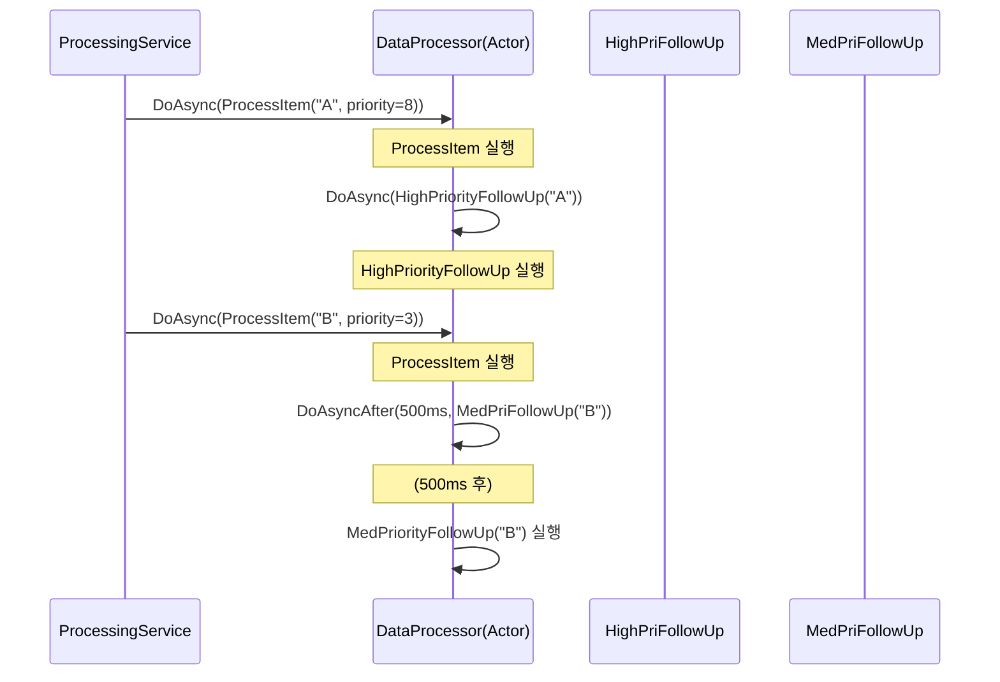
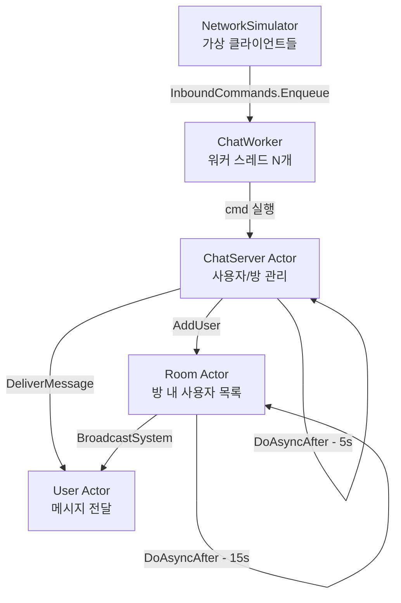

# 제5장: 콘솔과 채팅 서버 예제 분석

ExampleConsoleApp으로 작업 등록, 타이머와 워커 사용법을 익힌 뒤 ExampleChatServer로 확장한다. 콘솔의 단일 Actor에서 채팅 서버의 ChatServer·Room·User 협업까지 단계적으로 따라간다.

## 5.1 ExampleConsoleApp — 프로젝트 구조

```
ExampleConsoleApp/
├── Program.cs              ← 세 가지 예제를 실행하는 진입점
├── TestObject.cs           ← 가장 기본적인 AsyncExecutable 구현
├── TestWorkerThread.cs     ← IRunnable 구현
├── DataProcessor.cs        ← Actor 스타일 심화 예제
└── ProcessingService.cs    ← DataProcessor를 래핑하는 서비스
```

이 프로젝트는 세 가지 예제를 순서대로 실행합니다:

```
main() 실행
    │
    ├── BasicExampleAsync()       ← 예제 1: DoAsync/DoAsyncAfter 기본
    │
    ├── WorkerThreadExampleAsync() ← 예제 2: IRunnable + JobDispatcher
    │
    └── AdvancedExampleAsync()    ← 예제 3: Actor 스타일 DataProcessor
```

---

## 5.2 TestObject — 가장 단순한 Actor

```csharp
public class TestObject : AsyncExecutable
{
    private int _testCount;  // lock 없이 안전하게 쓸 수 있는 필드

    public void TestFunc0()
    {
        Interlocked.Increment(ref _testCount);
    }

    public void TestFunc1(int b)
    {
        Interlocked.Add(ref _testCount, b);
    }

    public void TestFunc2(double a, int b)
    {
        Interlocked.Add(ref _testCount, b);

        // Actor 내부에서 자기 자신에게 다시 DoAsync!
        // → 새 작업이 현재 큐에 추가됨 (직렬 실행 보장)
        if (a < 50.0)
        {
            DoAsync(() => TestFunc1(b));
        }
    }

    public void TestFuncForTimer(int b)
    {
        // 50% 확률로 재귀적 타이머 예약
        if (Random.Shared.Next(2) == 0)
        {
            DoAsyncAfter(TimeSpan.FromSeconds(1), () => TestFuncForTimer(-b));
        }
    }

    public int GetTestCount() => _testCount;
}
```

> `TestFuncForTimer` 는 "자기 자신을 다시 예약"하는 옛 패턴을 일부러 남겨 둔 예제입니다.
> 실제 주기 작업에는 `DoAsyncEvery` 를 쓰세요 (3.5) — 예외에 강하고 취소가 쉽습니다.
> `DoAsyncAfter` 는 이제 `ITimerHandle` 을 반환하므로, 위처럼 반환값을 버리면 나중에
> 취소할 방법이 없다는 점도 기억해 두세요.

잠깐! `_testCount`에 `Interlocked.Add`를 쓰고 있습니다. Actor 내부에서 실행되는데 왜 Interlocked을 쓸까요?

```
설명:
─────────────────────────────────────────────────────────
TestObject는 AsyncExecutable을 상속하므로 내부 메서드들은
항상 직렬 실행됩니다.

하지만 GetTestCount()는 외부 스레드에서 직접 호출될 수 있습니다!
  TestObject._testCount를 읽기 위해 직접 호출하면
  → 읽기와 쓰기가 동시에 발생 가능

완전한 Actor 모델이라면 GetTestCount()도 큐를 통해야 합니다.
이 예제는 간단함을 위해 Interlocked를 사용한 것입니다.

실제 서버에서는 GetSnapshot() 패턴을 쓰는 것이 더 안전합니다!
─────────────────────────────────────────────────────────
```

---

## 5.3 예제 1: BasicExampleAsync

```csharp
static async Task BasicExampleAsync()
{
    Console.WriteLine("Basic Example:");

    await using var testObject = new TestObject();

    // ① 즉시 실행 — 큐에 넣고 이 스레드(Main)에서 바로 Flush!
    testObject.DoAsync(() => testObject.TestFunc0());
    testObject.DoAsync(() => testObject.TestFunc1(5));
    testObject.DoAsync(() => testObject.TestFunc2(25, 10));

    // ② 500ms 후 실행 — 시스템의 타이머 스레드에 예약
    testObject.DoAsyncAfter(TimeSpan.FromMilliseconds(500),
        () => testObject.TestFunc1(15));

    // ③ 500ms + 처리 시간을 기다림
    await Task.Delay(1000);

    Console.WriteLine($"Test count: {testObject.GetTestCount()}");
}
```

실행 순서 추적:

```
DoAsync(TestFunc0)
    → CAS 0→1  — 내가 첫 번째, 즉 leader!
    → 큐에 넣기
    → Flush 시작 (Main 스레드에서)
        TestFunc0 실행  (_testCount += 1)          ← +1
        Decrement(count=0)  — 큐 비었음 → return

DoAsync(TestFunc1(5))
    → CAS 0→1  — 또 첫 번째!
    → Flush 시작
        TestFunc1(5) 실행  (_testCount += 5)       ← +5
        Decrement(count=0)  — return

DoAsync(TestFunc2(25, 10))
    → CAS 0→1
    → Flush 시작
        TestFunc2(25, 10) 실행
            Interlocked.Add(10)                    ← +10
            a(25) < 50.0 → DoAsync(TestFunc1(10))
                → CAS 1→2  ← 이미 leader 가 있으므로 큐에만 넣기
        Decrement(count=1)  — 아직 작업 있음
        TestFunc1(10) 실행  (_testCount += 10)     ← +10
        Decrement(count=0)  — return

DoAsyncAfter(500ms, TestFunc1(15))
    → 타이머 스레드(JobTimer-default)의 PriorityQueue 에 예약
    → 500ms 후 만료 → testObject 의 큐로 투입
    → 이 프로세스에는 워커가 없다 → 타이머 스레드가 그 자리에서 Flush
       (Warn 로그 1회: "JobSystem 'default' has no worker threads ...")
        TestFunc1(15) 실행  (_testCount += 15)     ← +15

최종: _testCount = 1 + 5 + 10 + 10 + 15 = 41
출력:  Test count: 41
```

### ⚠️ v2.0 에서는 여기서 26 이 나왔습니다

이 예제는 P0-3 결함의 재현 코드이기도 합니다.

```
v2.0 출력:  Test count: 26      ( = 1 + 5 + 10 + 10 )
v2.1 출력:  Test count: 41      ( = 26 + 15 )
```

만료된 타이머 작업이 워커만 드레인하는 큐로 들어갔는데, 이 예제에는 `JobDispatcher` 가
없습니다. 그래서 `TestFunc1(15)` 이 **영원히 실행되지 않았고**, 경고도 없었습니다.
"디스패처 없이도 지연 실행이 정상 트리거된다"는 예전 설명은 v1 시절의 동작이었고,
v2.0 에서는 사실이 아니었습니다.

지금은 워커가 없으면 타이머 스레드가 직접 flush 합니다. 다시 "디스패처 없이도 동작"하지만,
**그 경우 콜백이 워커가 아니라 타이머 스레드에서 실행된다**는 조건이 붙습니다. 그래서 첫
발화 때 경고를 한 번 남깁니다. 실제 서버라면 `JobDispatcher` 를 띄우세요.

---

## 5.4 TestWorkerThread — IRunnable 구현

```csharp
public class TestWorkerThread : IRunnable
{
    private readonly List<TestObject> _testObjects = new();
    private const int TestObjectCount = 10;

    public TestWorkerThread()
    {
        // 이 워커가 소유할 10개의 TestObject 생성
        for (int i = 0; i < TestObjectCount; i++)
        {
            _testObjects.Add(new TestObject());
        }
    }

    public bool Run(CancellationToken cancellationToken)
    {
        if (cancellationToken.IsCancellationRequested)
            return false;

        int after = Random.Shared.Next(2000);  // 0~2000ms

        if (after > 1000)  // 절반 확률
        {
            // 랜덤 TestObject들에 작업 보내기
            int i1 = Random.Shared.Next(TestObjectCount);
            int i2 = Random.Shared.Next(TestObjectCount);
            int i3 = Random.Shared.Next(TestObjectCount);
            int i4 = Random.Shared.Next(TestObjectCount);

            _testObjects[i1].DoAsync(() => _testObjects[i1].TestFunc0());
            _testObjects[i2].DoAsync(() =>
                _testObjects[i2].TestFunc2(Random.Shared.Next(100), 2));
            _testObjects[i3].DoAsync(() => _testObjects[i3].TestFunc1(1));

            // 지연 실행도 테스트
            _testObjects[i4].DoAsyncAfter(
                TimeSpan.FromMilliseconds(after),
                () => _testObjects[i4].TestFuncForTimer(after));
        }

        // 카운트가 5000을 넘으면 강제 종료 (조기 종료 테스트)
        if (_testObjects[Random.Shared.Next(TestObjectCount)].GetTestCount() > 5000)
        {
            Console.WriteLine($"Thread {Environment.CurrentManagedThreadId} end by force");
            return false;  // ← false 반환으로 이 워커 종료
        }

        Thread.Sleep(1);  // CPU 양보
        return true;
    }

    public void Dispose()
    {
        // TestObject들을 비동기로 Dispose (큐 drain 대기)
        foreach (var testObject in _testObjects)
        {
            testObject.DisposeAsync().AsTask().Wait();
        }
    }
}
```

---

## 5.5 예제 2: WorkerThreadExampleAsync

```csharp
static async Task WorkerThreadExampleAsync()
{
    Console.WriteLine("Worker Thread Example:");

    // 4개의 전용 OS 스레드로 TestWorkerThread 실행
    await using var dispatcher = new JobDispatcher<TestWorkerThread>(4);

    // 스레드 시작 + 모든 완료를 기다리는 Task 반환
    var dispatcherTask = Task.Run(async () =>
        await dispatcher.RunWorkerThreadsAsync());

    // 5초 동안 실행
    Console.WriteLine("Running worker threads for 5 seconds...");
    await Task.Delay(TimeSpan.FromSeconds(5));

    // 종료 신호 + 스레드 Join
    Console.WriteLine("Stopping worker threads...");
    await dispatcher.DisposeAsync();

    Console.WriteLine("All workers have completed");
}
```

4개 워커 스레드의 동작:

```
JobWorker-0 (OS Thread A):
    TestWorkerThread-0 생성
    Run() 반복:
      → TestObject 0~9에 랜덤으로 DoAsync/DoAsyncAfter
      → 카운트 체크 → 5000 초과하면 false 반환
      → Dispose: TestObject들 drain 대기

JobWorker-1 (OS Thread B):
    TestWorkerThread-1 생성
    Run() 반복: (독립적으로!)

JobWorker-2 (OS Thread C): ...
JobWorker-3 (OS Thread D): ...

★ 같은 TestObject에 여러 워커가 DoAsync를 보낼 수 있음
  → 입장 CAS 가 leader 를 단 하나로 정한다 → 동시 실행 없음
  → 어떤 워커가 Flush하든 "한 번에 하나씩"이 보장된다
    (단, 서로 다른 producer 중 누가 먼저 넣는지는 보장되지 않는다 — 4장 Sequencer)
```

---

## 5.6 DataProcessor — Actor 스타일 심화

```csharp
public class DataProcessor : AsyncExecutable
{
    // lock이 단 하나도 없는 컬렉션!
    private readonly Dictionary<string, int> _processedItems = new();

    // 외부 진입점: 큐에 넣기만
    public void ProcessItem(string itemId, int priority)
    {
        Console.WriteLine($"[Thread {Environment.CurrentManagedThreadId}] " +
                          $"Processing {itemId} priority={priority}");

        Thread.Sleep(100 * (1 + Random.Shared.Next(5)));  // 처리 시뮬레이션

        // ★ lock 없이 안전하게 딕셔너리 갱신!
        if (_processedItems.TryGetValue(itemId, out var count))
            _processedItems[itemId] = count + 1;
        else
            _processedItems[itemId] = 1;

        // 우선순위에 따라 자기 자신에게 후속 작업 예약
        if (priority > 5)
            DoAsync(() => HighPriorityFollowUp(itemId));    // 즉시
        else if (priority > 2)
            DoAsyncAfter(TimeSpan.FromMilliseconds(500),
                () => MediumPriorityFollowUp(itemId));      // 500ms 후
    }

    private void HighPriorityFollowUp(string itemId) { ... }
    private void MediumPriorityFollowUp(string itemId) { ... }

    // ★ 중요: 읽기도 큐를 통과!
    public Task<Dictionary<string, int>> GetProcessingStatsAsync()
    {
        var tcs = new TaskCompletionSource<Dictionary<string, int>>(
            TaskCreationOptions.RunContinuationsAsynchronously);

        DoAsync(() => tcs.SetResult(new Dictionary<string, int>(_processedItems)));

        return tcs.Task;
    }
}
```

> **지금은 `Ask` 한 줄이면 됩니다.**
> ```csharp
> public Task<Dictionary<string, int>> GetProcessingStatsAsync()
>     => Ask(() => new Dictionary<string, int>(_processedItems));
> ```
> `Ask` 는 위와 똑같이 큐를 통과시키면서, 핸들러가 예외를 던지면 Task 를 실패시키고,
> 큐에 들어가지 못하면 `JobRejectedException` 으로 실패시킵니다. 손으로 만든
> `TaskCompletionSource` 는 거부됐을 때 영원히 완료되지 않는다는 함정이 있습니다.

왜 GetProcessingStatsAsync에서 큐를 사용하나요?

```
잘못된 방법 (직접 읽기):
──────────────────────────────────────────────────────────
// 이렇게 하면:
public Dictionary<string, int> GetStats()
    => new Dictionary<string, int>(_processedItems);

외부 스레드에서 호출:
  Thread-External: new Dict(_processedItems)  ← 복사 시작
  DataProcessor 큐: ProcessItem() 실행 중
    → _processedItems 수정!
  Thread-External: 복사 진행 중 ← 중간 상태 읽기!

올바른 방법 (큐를 통해 읽기):
──────────────────────────────────────────────────────────
DoAsync(() => tcs.SetResult(new Dict(_processedItems)))

→ ProcessItem이 모두 처리된 후에 읽기 실행
→ 일관된 스냅샷 보장!
→ 큐 순서에 따른 happens-before 일관성
```

---

## 5.7 예제 3: AdvancedExampleAsync

```csharp
static async Task AdvancedExampleAsync()
{
    await using var processingService = new ProcessingService();

    processingService.Start();

    // 5초 동안 실행
    await Task.Delay(TimeSpan.FromSeconds(5));

    // 통계 조회 — 큐를 통과하므로 안전!
    var stats = await processingService.Processor.GetProcessingStatsAsync();

    Console.WriteLine("\nProcessing Statistics:");
    Console.WriteLine($"Total unique items: {stats.Count}");
    Console.WriteLine($"Total operations: {stats.Values.Sum()}");

    foreach (var item in stats.OrderByDescending(x => x.Value))
        Console.WriteLine($"{item.Key}: {item.Value}회");
}
```

ProcessingService의 역할:

```csharp
public class ProcessingService : IAsyncDisposable
{
    private readonly DataProcessor _processor = new();

    public void Start()
    {
        // 별도 Task에서 작업을 DataProcessor에 보냄
        _processingTask = Task.Run(async () =>
        {
            for (int i = 0; i < _itemCount && !token.IsCancellationRequested; i++)
            {
                string item = _items[Random.Shared.Next(_items.Count)];
                int priority = Random.Shared.Next(1, 10);

                // ★ DoAsync로 DataProcessor 큐에 넣기
                _processor.DoAsync(() => _processor.ProcessItem(item, priority));

                await Task.Delay(Random.Shared.Next(10, 50), token);
            }
        }, token);
    }
}
```

---

## 5.8 우선순위 후속 작업 다이어그램



---

## 5.9 ExampleConsoleApp — 핵심 학습 포인트 정리

```
BasicExample에서:
✓ DoAsync는 즉시 Flush를 돌려 같은 스레드(Main)에서 처리
✓ DoAsyncAfter는 시스템의 타이머 스레드에 예약된다
✓ 워커가 없으면 타이머 콜백이 타이머 스레드에서 실행된다 (경고 1회)
✓ Actor 내부에서 DoAsync 호출 시 기존 Flush에 합류
✓ 기대 출력은 41 — 26 이 나온다면 v2.0 이하다 (P0-3)

WorkerThreadExample에서:
✓ IRunnable + JobDispatcher<T> = 전용 OS 스레드
✓ 여러 워커가 같은 Actor에 DoAsync → 입장 CAS 가 직렬 실행을 보장
✓ Run()이 false 반환 → 해당 워커만 종료 (다른 워커 유지)
✓ 자체 루프가 필요 없다면 비제네릭 JobDispatcher 가 더 낫다 (3.13)

AdvancedExample에서:
✓ 읽기도 큐를 통과 → 일관된 스냅샷
✓ 결과 회수는 손수 만든 TaskCompletionSource 대신 Ask 로
✓ 자기 자신에게 후속 작업 예약 가능
```

---

콘솔 예제로 기본 API와 워커 사용법을 확인했다. 이제 여러 Actor가 협업하는 채팅 서버에서 같은 원리를 적용한다.

## 5.10 ExampleChatServer — 프로젝트 구조

```
ExampleChatServer/
├── Program.cs           ← 시뮬레이션 실행
├── ChatServer.cs        ← 최상위 서버 Actor
├── ChatWorker.cs        ← IRunnable 워커
├── Room.cs              ← 방 Actor
├── User.cs              ← 사용자 Actor
├── Defines.cs           ← 메시지 타입, 레코드 등
└── NetworkSimulator.cs  ← 가상 클라이언트 시뮬레이션
```

---

## 5.11 ExampleChatServer — 전체 구조 다이어그램



---

## 5.12 ChatServer — 최상위 Actor

### 코딩 컨벤션

ChatServer는 두 종류의 메서드를 명확히 구분합니다:

```csharp
public sealed class ChatServer : AsyncExecutable
{
    // ── 외부 진입점 (public Handle*) ──────────────────────
    // 규칙: DoAsync로 큐에 넣기만 한다

    public void HandleUserConnect(IChatClient client)
        => DoAsync(() => ProcessUserConnect(client));

    public void HandleRoomJoin(string userId, string roomId)
        => DoAsync(() => ProcessRoomJoin(userId, roomId));

    public void HandleRoomChat(string userId, string roomId, string content)
        => DoAsync(() => ProcessRoomChat(userId, roomId, content));

    // ── 실제 처리 (private Process*) ─────────────────────
    // 규칙: ChatServer 큐에서 직렬 실행, 여기서 상태 변경

    private void ProcessUserConnect(IChatClient client)
    {
        // ★ _users 딕셔너리 — lock 없이 안전!
        var user = new User(client);
        _users[user.UserId] = user;
        BroadcastSystemToAll(MessageType.UserConnect, $"{user.Username}님이 접속하셨습니다.");
    }

    private void ProcessRoomJoin(string userId, string roomId)
    {
        if (_users.TryGetValue(userId, out var user) &&
            _rooms.TryGetValue(roomId, out var room))
        {
            // ★ Room Actor에게 메시지 패싱!
            room.AddUser(user);  // room.DoAsync(() => room.ProcessAddUser(user))
        }
    }
}
```

---

## 5.13 서버 생명주기

```csharp
public void Start()
{
    // 1. 기본 방 생성 (Actor 큐로!)
    DoAsync(CreateDefaultRooms);

    // 2. 워커 스레드 시작
    _dispatcher = new JobDispatcher<ChatWorker>(_workerCount);
    _ = _dispatcher.RunWorkerThreadsAsync();

    // 3. Heartbeat 시작 (자기복제 패턴)
    DoAsync(StatsHeartbeat);   // 5초마다 통계 출력
    DoAsync(IdleScanHeartbeat); // 10초마다 유휴 사용자 체크
}

public void Stop()
{
    Console.WriteLine("[Server] 종료 시작");
    _stopped = true;

    DoAsync(ForceCleanupAllRooms);

    // 자기 큐 drain 대기 (ValueTask 를 Task 로 바꿔 한 번만 차단)
    DisposeAsync().AsTask().Wait();

    // v2.1: 남은 작업 drain → 타이머 스레드 정지 → 워커 정지까지 한 번에.
    System.StopAsync(TimeSpan.FromSeconds(5)).GetAwaiter().GetResult();
    Console.WriteLine("[Server] 종료 완료");
}
```

> **셧다운이 한 줄로 줄어든 이유.**
> v2.0 까지 이 자리에는 세 줄이 있었습니다.
>
> ```csharp
> _dispatcher?.Dispose();          // 워커 정지
> TimerRegistry.DisposeAll();      // 비-워커 스레드가 만든 TimerQueue 정리
> // (+ 상황에 따라 AsyncExecutable.AcceptingWork = false)
> ```
>
> 지금은 타이머를 `JobSystem` 이 소유하므로 정리할 `TimerQueue` 가 애초에 없고
> (`TimerRegistry` 는 `[Obsolete]` no-op 으로만 남아 있습니다 — 3.9 참고),
> `StopAsync` 하나가 **드레인 → 타이머 스레드 정지 → 이 시스템에 붙은 디스패처 정지**를
> 순서대로 처리합니다.
>
> `AsyncExecutable` 을 상속한 클래스는 `System` 프로퍼티로 자기가 속한 `JobSystem` 에
> 바로 접근할 수 있습니다. 반환값이 `false` 면 타임아웃 안에 다 비우지 못했다는 뜻이니
> 로그를 남겨 두는 편이 좋습니다.
>
> ```csharp
> if (!await System.StopAsync(TimeSpan.FromSeconds(10)))
>     JobLog.Warn("일부 작업이 남은 채로 종료되었습니다");
> ```
>
> 6장의 `AdvancedMmorpgServer` 도 같은 형태입니다.

---

## 5.14 자기복제 Heartbeat 패턴

```csharp
private void StatsHeartbeat()
{
    if (_stopped) return;  // ← 종료 체크 (자기복제 탈출)

    // 실제 작업: 통계 출력
    Console.WriteLine($"사용자 {_users.Count}명 / 방 {_rooms.Count}개");

    // 자기 자신을 5초 후에 다시 예약
    DoAsyncAfter(_statsPeriod, StatsHeartbeat);
}

private void IdleScanHeartbeat()
{
    if (_stopped) return;

    // 각 사용자에게 유휴 체크 요청
    foreach (var user in _users.Values)
        user.CheckIdleAndDisconnect(this, _idleThresholdMs);

    DoAsyncAfter(_idleScanPeriod, IdleScanHeartbeat);
}
```

> **지금은 `DoAsyncEvery` 로 쓰는 편이 낫습니다.**
> ```csharp
> private ITimerHandle? _stats;
> private ITimerHandle? _idleScan;
>
> public void StartHeartbeats()
>     => DoAsync(() =>
>     {
>         _stats    = DoAsyncEvery(_statsPeriod,    PrintStats);
>         _idleScan = DoAsyncEvery(_idleScanPeriod, ScanIdleUsers);
>     });
>
> public void StopHeartbeats()   // _stopped 플래그 대신 진짜 취소
> {
>     _stats?.Cancel();
>     _idleScan?.Cancel();
> }
> ```
> 위의 자기복제 패턴에는 두 가지 문제가 있습니다. ① `PrintStats` 가 예외를 던지면
> 마지막 줄에 도달하지 못해 heartbeat 가 **영원히** 멈춥니다. ② `_stopped` 플래그는
> "발화는 하되 아무것도 안 함"이므로, 셧다운 시 타이머가 계속 새 작업을 만들어
> 드레인이 끝나지 않습니다. `DoAsyncEvery` + `Cancel()` 은 둘 다 해결합니다 (3.5).

---

## 5.15 Room — 방 Actor

```csharp
public sealed class Room : AsyncExecutable
{
    private readonly Dictionary<string, User> _users = [];

    // ── 외부 진입점 ───────────────────────────────────────

    public void AddUser(User user) => DoAsync(() => ProcessAddUser(user));
    public void RemoveUser(string userId) => DoAsync(() => ProcessRemoveUser(userId));
    public void BroadcastChat(string senderId, string content)
        => DoAsync(() => ProcessBroadcastChat(senderId, content));

    // ── 실제 처리 ─────────────────────────────────────────

    private void ProcessAddUser(User user)
    {
        if (!_users.TryAdd(user.UserId, user)) return;

        Console.WriteLine($"[Room {_roomId}] 입장: {user.Username}");
        BroadcastSystem(MessageType.RoomJoin, $"{user.Username}님이 입장하셨습니다.");
        user.NoteRoomJoined(_roomId);  // ← User Actor에게 메시지 패싱!
    }

    private void ProcessBroadcastChat(string senderId, string content)
    {
        if (!_users.TryGetValue(senderId, out var sender)) return;

        sender.TouchActivity();

        var message = new ChatMessage(
            Guid.NewGuid(), MessageType.RoomChat,
            sender.Username, null, _roomId, content, DateTimeOffset.UtcNow);

        // ★ 모든 User Actor에게 메시지 전달
        foreach (var user in _users.Values)
            user.DeliverMessage(message);  // 각 User의 DoAsync 호출
    }

    // ── Heartbeat (자기복제) ──────────────────────────────

    private void Heartbeat(TimeSpan period)
    {
        if (_stopped) return;

        if (_users.Count > 0)
        {
            BroadcastSystem(MessageType.RoomChat,
                $"현재 {_name} 방에 {_users.Count}명이 있습니다.");
        }

        // 다음 heartbeat 예약
        DoAsyncAfter(period, () => Heartbeat(period));
    }
}
```

---

## 5.16 User — 사용자 Actor

```csharp
public sealed class User : AsyncExecutable
{
    private long _lastActivityTickMs;  // lock 없이 안전한 필드

    // ── 외부 진입점 ───────────────────────────────────────

    public void DeliverMessage(ChatMessage message)
        => DoAsync(() => ProcessDeliverMessage(message));

    public void TouchActivity()
        => DoAsync(() => _lastActivityTickMs = Environment.TickCount64);

    public void CheckIdleAndDisconnect(ChatServer server, long thresholdMs)
        => DoAsync(() => ProcessCheckIdleAndDisconnect(server, thresholdMs));

    // ── 실제 처리 ─────────────────────────────────────────

    private void ProcessDeliverMessage(ChatMessage message)
    {
        _lastActivityTickMs = Environment.TickCount64;
        // 네트워크 전송 (User Actor 큐에서 직렬 실행 → 다른 Actor 안 막음!)
        _client.SendMessage(message);
    }

    private void ProcessCheckIdleAndDisconnect(ChatServer server, long thresholdMs)
    {
        long idle = Environment.TickCount64 - _lastActivityTickMs;
        if (idle > thresholdMs)
        {
            Console.WriteLine($"{Username} 유휴 {idle}ms — 자동 종료");
            // ★ Actor → Actor 메시지 패싱
            server.HandleUserDisconnect(UserId);
        }
    }
}
```

---

## 5.17 GetSnapshot 패턴 — 안전한 읽기

외부에서 상태를 읽어야 할 때 사용하는 패턴입니다:

```csharp
// Room.cs
public RoomSnapshot GetSnapshot()
{
    using var ev = new ManualResetEventSlim(false);
    RoomSnapshot? result = null;

    DoAsync(() =>
    {
        // Room 큐 안에서 실행 → _users 안전하게 읽기!
        result = new RoomSnapshot(_roomId, _name, _users.Keys.ToList());
        ev.Set();  // 완료 신호!
    });

    ev.Wait();  // 완료 신호 대기
    return result!;
}
```

단계별 동작:

```
외부 스레드             Room Actor 큐
      │
      ├─ DoAsync(람다)
      │   → 큐에 람다 추가
      │
      └─ ev.Wait()  ─────────── (대기 중...)
                                    │
                     큐에서 람다 실행
                     result = 스냅샷
                     ev.Set()  ──────────► 대기 해제!
      │
      └─ return result!
```

### 지금은 AskSync 를 쓰세요

같은 일을 라이브러리가 해 줍니다. 그리고 **훨씬 중요한 차이가 하나 있습니다.**

```csharp
// Room.cs 를 v2.1 스타일로
public RoomSnapshot GetSnapshot()
    => AskSync(() => new RoomSnapshot(_roomId, _name, _users.Keys.ToList()),
               TimeSpan.FromSeconds(2));
```

```
직접 만든 ManualResetEventSlim 버전   vs   AskSync

  ev.Wait() 는 무한 대기                    timeout 필수 → 영구 정지 없음
  큐에 못 들어가도 그냥 멈춘다              거부되면 JobRejectedException
  actor 안에서 부르면 조용히 데드락 ★       actor 안에서 부르면 즉시 예외 ★
```

★ 이 줄이 핵심입니다. `AskSync` 는 첫 줄에서 `JobDiagnostics.GuardBlockingWait` 를 부릅니다.

```
❌ 잘못된 사용:
void ProcessSomething()  // ChatServer 큐 안에서 실행 중
{
    var snap = room.GetSnapshot();
    // 예전: ChatServer 큐가 ev.Wait 에서 멈춤 → Room 의 작업을 처리해 줄 스레드가
    //       바로 지금 멈춰 있는 이 스레드 → 조용한 데드락, 원인 파악 매우 어려움
    // 지금: InvalidOperationException — "actor 'ChatServer' 안에서 AskSync 를 불렀다"
}

✅ 올바른 사용:
// 외부 스레드(메인, 콘솔 명령, 통계 수집 등)에서 호출
var snapshot = server.GetSnapshot();

✅ actor 안에서 다른 actor 의 데이터가 필요하다면 — 메시지 패싱
private void ProcessSomething()
{
    room.RequestSnapshot(this);   // room 이 결과를 이쪽 큐로 DoAsync 해 준다
}
```

이 가드는 `JobSystemOptions.DetectBlockingWaitOnWorker` 로 켜고 끕니다 (DEBUG 기본 on).

---

## 5.18 ChatWorker — 워커 스레드

```csharp
public class ChatWorker : IRunnable
{
    // IO 스레드/시뮬레이션이 명령을 여기에 push
    public static readonly ConcurrentQueue<Action> InboundCommands = new();

    public static long TotalProcessed => Interlocked.Read(ref _totalProcessed);
    private static long _totalProcessed;

    private long _localProcessed;
    private long _lastLogTick;

    public bool Run(CancellationToken cancellationToken)
    {
        if (cancellationToken.IsCancellationRequested) return false;

        if (InboundCommands.TryDequeue(out var cmd))
        {
            try
            {
                cmd();           // 여기서 ChatServer.HandleX 실행
                _localProcessed++;
                Interlocked.Increment(ref _totalProcessed);
            }
            catch (Exception ex)
            {
                Console.Error.WriteLine($"명령 실행 실패: {ex.Message}");
            }
        }
        else
        {
            Thread.Sleep(1);  // 큐 비어있으면 양보
        }

        // ThreadLocal TickCount로 주기 로그
        long now = ThreadContext.TickCount;
        if (now - _lastLogTick >= 5000)
        {
            _lastLogTick = now;
            Console.WriteLine($"[Worker] tick={now}ms 처리={_localProcessed}건");
        }

        return true;
    }
}
```

> **이 워커는 v2.1 에서는 필요 없습니다.**
> `InboundCommands` + `TryDequeue` + `Thread.Sleep(1)` 조합은 라이브러리에 ready 큐와
> 시그널 대기가 없던 시절의 우회책입니다. 지금은:
>
> ```csharp
> // 워커: 사용자 루프 없음. 유휴 시 CPU 0%, 유입 지연은 마이크로초.
> _dispatcher = new JobDispatcher(_workerCount, new JobDispatcherOptions { System = _system });
> _ = _dispatcher.RunWorkerThreadsAsync();
>
> // 외부(IO/시뮬레이션) 스레드: 중계 큐 대신
> _system.Post(() => server.HandleRoomChat(userId, roomId, content));
>
> // 세션별 순서 보장이 필요하면 Sequencer 가 알아서 Post 한다 (4장)
> new Sequencer<string>(_system, handler: HandleOnePacket);
> ```
>
> `Thread.Sleep(1)` 폴링은 워커 8개면 초당 8,000회 깨어나고, Windows 타이머 해상도
> 때문에 1~15ms 의 유입 지연을 만듭니다. `ExampleChatServer` 는 옛 방식의 참고용으로
> 남아 있고, 이관된 형태는 6장의 `AdvancedMmorpgServer` 에서 볼 수 있습니다.

---

## 5.19 전체 메시지 흐름

실제 채팅 메시지가 처리되는 과정을 따라가봅시다:

```
클라이언트: "안녕!"을 general 방에 보냄

①  NetworkSimulator (또는 실제 IO 스레드)
     ChatWorker.InboundCommands.Enqueue(
         () => server.HandleRoomChat("user1", "general", "안녕!"))

②  ChatWorker.Run()
     InboundCommands.TryDequeue() → cmd 꺼내기
     cmd()  →  server.HandleRoomChat("user1", "general", "안녕!")

③  ChatServer.HandleRoomChat
     DoAsync(() => ProcessRoomChat("user1", "general", "안녕!"))
     → ChatServer 큐에 추가
     → ChatWorker 스레드가 Flush 실행
     → ProcessRoomChat 실행

④  ProcessRoomChat (ChatServer 큐 안)
     room = _rooms["general"]
     room.BroadcastChat("user1", "안녕!")
     → Room 큐에 추가

⑤  Room.ProcessBroadcastChat (Room 큐 안)
     sender = _users["user1"]
     sender.TouchActivity()
     메시지 생성
     for each user in _users:
         user.DeliverMessage(message)
         → 각 User 큐에 추가

⑥  User.ProcessDeliverMessage (User 큐 안)
     _client.SendMessage(message)
     → 실제 네트워크 전송 (여기서만 네트워크 IO!)
```

---

## 5.20 Actor 간 격리의 장점

```
Room 전체에 100명이 있을 때 채팅 처리:

전통적 방법 (lock):
  for each user:
    lock(user)
    send()
    unlock(user)
  → 직렬! 100명 차례로 전송

Actor 방법:
  for each user:
    user.DeliverMessage()  → 각 User 큐에 추가 (즉시 반환!)
  → Room은 즉시 다음 작업으로!
  → 100명의 User Actor가 병렬로 전송!
  → 느린 클라이언트(네트워크 지연)가 다른 사람에게 영향 없음!
```

---

## 5.21 ExampleChatServer — 핵심 학습 포인트

```
ChatServer 예제에서:
✓ 세 Actor(ChatServer, Room, User) 협업 구조
✓ Handle*/Process* 코딩 컨벤션
✓ 주기 작업 — 예제는 자기복제, 새 코드는 DoAsyncEvery + ITimerHandle
✓ 외부 읽기 — 예제는 ManualResetEventSlim, 새 코드는 AskSync
✓ Actor → Actor 메시지 패싱 (server.HandleUserDisconnect)
✓ 워커 스레드에서 ThreadContext.TickCount로 주기 로그
✓ actor 큐 안에서의 동기 대기는 데드락 — 이제 AskSync 가 예외로 잡아 준다
✓ 셧다운은 System.StopAsync 한 번 (TimerRegistry.DisposeAll 은 이제 no-op)
✓ 이 예제의 InboundCommands 중계 큐는 v2.0 스타일이다
  (이관된 형태는 6장)
```

---

*[← 제4장: Sequencer와 설정·모니터링·로깅](./chapter04.md) | [↑ 목차](./README.md) | [→ 제6장: MMORPG 서버의 기본 구조와 고급 패턴](./chapter06.md)*
